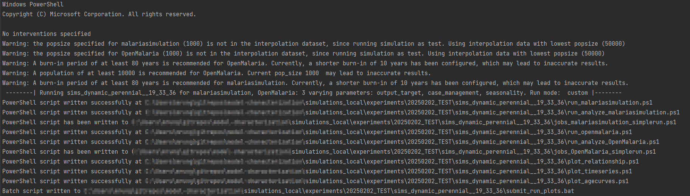

# Example run 


This example will guide you through running simulations, assuming that all requirements are met: 
the necessary software is installed and user settings are properly configured in the `manifest.py` file. 
If you need to modify your setup, please visit the [installation ](../getting_started/installation.md) or [first-time-configuration](../getting_started/configuration.md) pages.  

Alternatively, you can run MultiMalModPy from within a container, bypassing the need for prior installation (see the "Using Singularity or Docker container" section below). 

**In this section:**  

- [HPC](#hpc)  
  - [Using Python Virtual Environment](#using-python-virtual-environment-on-hpc)  
  - [Using Singularity Container](#using-singularity-container)  
- [Local](#local)  
  - [Using Python Virtual Environment](#using-python-virtual-environment-on-local)  
     - [Launch in Batch Mode](#launch-in-batch-mode)
     - [Launch in Interactive Mode](#launch-in-interactive-mode)  
  - [Using Docker Container](#using-docker-container)  
    

------------------------------------ 

## HPC  

### Using python virtual environment on HPC  

**1️⃣ Navigate to the Repository and Activate the Virtual Environment**    

- **Navigate to the Repository**  
Open a terminal on your cluster and move into the MultiMalModPy repository using:  

    ``` 
    cd <your_path>/MultiMalModPy  
    ```
    Replace <your_path> with the actual path where the repository is located.  

- **Activate the Virtual Environment**    
To ensure dependencies are properly managed, activate the virtual environment:  

    ``` 
    source <your_path>/my_venv//bin/activate    
    ```  
    If you haven’t set up the virtual environment yet, follow the installation instructions [here](../getting_started/installation.md).      


**2️⃣ Configure Simulation to run (Optional for First Test Run)**    

To customize your simulation settings, modify the `setup_sim.py` file as needed.  
For your first test run, you can skip this step and proceed with the default settings. 
Later, you'll also learn how to run multiple simulations simultaneously using configurations from a CSV file.   

**3️⃣ Launch simulations**     

- **Launch the Simulation**  
   To run the simulation, use the following command:  

    ``` 
    python launch_sim.py --models EMOD malariasimulation OpenMalaria --test
    ```  
    _You can choose to run all three models (EMOD, malariasimulation, and OpenMalaria) or specify only one or two by modifying the command accordingly._   
    

- **Monitor Simulation Progress**  
    Check you simulations via `squeue -u <username>`. 
    While simulations are running, check the `experiments` and the `simulation_outputs` folder of your current simulation running.  
    In the `experiments` folder, you will find log files for each step and model, as well as the input files used for the simulationper model.  
    In the `simulation_outputs` folder, you can review the scenarios that were submitted in `scen_df.csv`, and  the outputs appear in the folder once the simulation finishes.     


-  **Postprocessing (optional if manual re-run is required)**    
Since the postprocessing runs automatically once the simulation job finishes, there is  no extra step required to process simulation outputs.   
In case of further content-debugging or customization needs, you can go to `Customize and troubleshoot analyzer` section.   

**4️⃣ View output**     

The output CSV files and figures will appear in the `simulation_outputs` folder.  

<div style="background-color: #E9F2F9; padding: 15px; border-left: 5px solid #00796b; margin: 20px 0; font-family: Arial, sans-serif;"> <strong><em>DONE!</em></strong>  
  If you see the CSV files and generated figures, congratulations—you've successfully run your first MultiMalModPy test simulation! 🎉  
 </div> 


**5️⃣ View log files (optional)**     

If the files are missing, check the `log` files for error messages and verify whether any raw simulation outputs were generated.  
The log files are located in the experiment folder under 'log'.

<div style="background-color: #E9F2F9; padding: 15px; border-left: 5px solid #00796b; margin: 20px 0; font-family: Arial, sans-serif;"> <strong><em>📝 NOTE!</em></strong>
  To debug or rerun specific steps, use the saved `.sh` files to execute each step separately and identify the issue.    
  <strong>malariasimulation</strong> and <strong>OpenMalaria</strong>. 
</div> 

Details on the process scripts (.sh, .err, .out etc.) are described [here]().

------------------------------------  

### Using singularity container   


**1️⃣ Navigate to the Repository and Activate the Virtual Environment**    

- **Navigate to the Repository**   
    Open a terminal on your cluster and move into the MultiMalModPy repository using:
    ``` 
    cd <your_path>/MultiMalModPy    
    ```
    Replace <your_path> with the actual path where the repository is located.  

- **Load singularity and ensure image file exists**
    ``` 
    module load singularity
    ```
    If you haven’t downloaded the image file yet, follow the download it from [here](../getting_started/installation.md) and save it under any directory on your HPC.     

- You can look inside the container via:    
    ```
    singularity shell /path/to/emodpy4.1-OM46-R4.4.1.sif  
    ``` 

**2️⃣ Configure Simulation to run (Optional for First Test Run)**    
If you want to customize your simulation settings, the easiest way is to modify the `setup_sim.py` file and adjust the parameters as needed.  
However, if this is your first test run, you can skip this step and proceed with the default settings.  
Later, you’ll also learn how to run multiple simulations simultaneously using configurations from a CSV file.     

**3️⃣ Launch simulations**  

- **Launch the Simulation**  
   To run the simulation, use the following command:  

```   

singularity exec -B /etc/slurm -B `which sbatch ` -B `which srun ` -B `which sacct ` -B `which scontrol ` -B `which salloc ` -B `which scancel ` -B `which squeue ` -B /usr/lib64/slurm/ -B /usr/lib64/libmunge.so.2 -B /usr/lib64/libmunge.so.2.0.0 -B /usr/lib64/libpmi2.so -B /usr/lib64/libpmi2.so.0 -B /usr/lib64/libpmi2.so.0.0.0 -B /usr/lib64/libpmi.so -B /usr/lib64/libpmi.so.0 -B /usr/lib64/libpmi.so.0.0.0 -B /run -B /usr/lib64/libnvidia-ml.so.1 -B /run -B /projects -B /scratch --writable-tmpfs /gpfs/projects/b1139/emod-om/container/emod-with-om-46-R-4.4.1.sif /opt/envs/emodpy39/bin/python3 launch_sim.py --models EMOD --test

```   
   
Note, the command includes at the very end the   
- location of the image file `/gpfs/projects/b1139/emod-om/emodpy4.1-OM46-R4.4.1.sif`  
- location of the python virtual environment within the container `/opt/envs/emodpy39/bin/python3 launch_sim.py`  
- MultiMalModPy submission command `launch_sim.py --models EMOD -- test`
_You can choose to run all three models (EMOD, malariasimulation, and OpenMalaria) or specify only one or two by modifying the command accordingly._    


- **Monitor Simulation Progress**    
    Check you simulations via `squeue -u <username>`. 
    While simulations are running, check the `experiments` and the `simulation_outputs` folder of your current simulation running.  
    In the `experiments` folder, you will find log files for each step and model, as well as the input files used for the simulationper model.  
    In the `simulation_outputs` folder, you can review the scenarios that were submitted in `scen_df.csv`, and  the outputs appear in the folder once the simulation finishes.     


- **Postprocessing (optional if manual re-run is required)**  
    Since the postprocessing runs automatically once the simulation job finishes, there is  no extra step required to process simulation outputs.   
    In case of further content-debugging or customization needs, you can go to `Customize and troubleshoot analyzer` section.   


**4️⃣ View output**     

The output CSV files and figures will appear in the `simulation_outputs` folder.  

<div style="background-color: #E9F2F9; padding: 15px; border-left: 5px solid #00796b; margin: 20px 0; font-family: Arial, sans-serif;"> <strong><em>DONE!</em></strong>  
  If you see the CSV files and generated figures, congratulations—you've successfully run your first MultiMalModPy test simulation! 🎉  
 </div> 


**5️⃣ View log files (optional)**     

If the files are missing, check the `log` files for error messages and verify whether any raw simulation outputs were generated.  
The log files are located in the experiment folder under 'log'.

<div style="background-color: #E9F2F9; padding: 15px; border-left: 5px solid #00796b; margin: 20px 0; font-family: Arial, sans-serif;"> <strong><em>📝 NOTE!</em></strong>
  To debug or rerun specific steps, use the saved `.sh` files to execute each step separately and identify the issue.    
  <strong>malariasimulation</strong> and <strong>OpenMalaria</strong>. 
</div> 

Details on the process scripts (.sh, .err, .out etc.) are described [here]().


------------------------------------ 


## Local    
This setup assumes that you are running it on a local machine using Windows.

### Using python virtual environment on local  

#### Launch in Batch Mode   

**1️⃣ Open a CLI Terminal**  
Open a command-line interface (CLI) terminal such as CMD, PyCharm terminal, or RStudio terminal. 
In the example below, we use the PyCharm terminal. 

**2️⃣ Configure Simulation to run (Optional for First Test Run)**    
If you want to customize your simulation settings, the easiest way is to modify the `setup_sim.py` file and adjust the parameters as needed.  
However, if this is your first test run, you can skip this step and proceed with the default settings.  
Later, you’ll also learn how to run multiple simulations simultaneously using configurations from a CSV file.     


**3️⃣ Run the Test Simulation**  
In the terminal, type the following command for a local test run: 

```   
python .\launch_sim.py --models malariasimulation OpenMalaria --test    
```  

**Pycharm**    
        

The resulting terminal output looks as below, after which two pop up windows appear:

<a href="https://github.com/ahadi-analytics/MultiMalModPy/tree/main/docs/img/2025-02-02 19_34_10-run_simulations.R.png" target="_blank">   
  
</a>  

- **Monitor Simulation Progress**
    Separate terminal windows per model appear that show the progress of the simulations that run locally.
    While simulations are running, check the `experiments` and the `simulation_outputs` folder of your current simulation running.  
    In the `experiments` folder, you will find log files for each step and model, as well as the input files used for the simulationper model.  
    In the `simulation_outputs` folder, you can review the scenarios that were submitted in `scen_df.csv`, and  the outputs appear in the folder once the simulation finishes.
   - OpenMalaria    

<a href="https://github.com/ahadi-analytics/MultiMalModPy/tree/main/docs/img/run_OpenMalaria_local.png" target="_blank"> 
  
</a>


   - malariasimulation  


<a href="https://github.com/ahadi-analytics/MultiMalModPy/tree/main/docs/img/run_malariasimulation_local.png" target="_blank">  
  
</a>


- **Postprocessing**   
    - **Automatic Processing**: The analyzer runs automatically once the simulation job is complete, so no additional steps are needed to process simulation outputs.
    - **Manual Debugging & Customization**: If further debugging or customization is required, navigate to the experiment folder and manually run the analyzer.bat file by double-clicking it.
    - **Plotting (Manual Step)**: Unlike when running on HPC, the plotting step is not automated on local setup when not running inside a container. 
       - After the simulations (including the analyzer) have finished, navigate to the experiment folder and manually run the plotter.bat file by double-clicking it.  


**4️⃣ View output**     

The output CSV files and figures will appear in the `simulation_outputs` folder.  

<div style="background-color: #E9F2F9; padding: 15px; border-left: 5px solid #00796b; margin: 20px 0; font-family: Arial, sans-serif;"> <strong><em>DONE!</em></strong>  
  If you see the CSV files and generated figures, congratulations—you've successfully run your first MultiMalModPy test simulation! 🎉  
 </div> 


**5️⃣ View log files (optional)**     

If the files are missing, check the `log` files for error messages and verify whether any raw simulation outputs were generated.  
The log files are located in the experiment folder under 'log'.

<div style="background-color: #E9F2F9; padding: 15px; border-left: 5px solid #00796b; margin: 20px 0; font-family: Arial, sans-serif;"> <strong><em>📝 NOTE!</em></strong>
  To debug or rerun specific steps, use the saved `.bat` or `.ps1` files to execute each step separately and identify the issue.    
  <strong>malariasimulation</strong> and <strong>OpenMalaria</strong>. 
</div> 

Details on the process scripts (.sh, .err, .out, .bat, .ps1 etc.) are described [here]().


#### Launch in Interactive Mode  

Running the script interactively can be useful for debugging or understanding specific lines of code. 

1️⃣ Open the MultiMalModPy project in an IDE such as PyCharm. 
2️⃣ Locate and open the launch_sim.py file. 
3️⃣ Execute the script line by line to inspect the behavior of each step. 
4️⃣ Once the script completes, PowerShell windows will appear, and the simulations will begin running.  

**Need to rerun the analyzer or plots?**  
- The analyzer and plotting scripts can also be run interactively.  
- To do this, comment out the `args` argument in the script.  
- Then, manually specify the `job_directory` and `models` within the script before execution.  


### Using Docker Container

To run MultiMalModPy inside a Docker container, follow these steps:

**1️⃣ Ensure the Docker image is available on your computer** 
- If you haven’t installed it yet, refer to the [installation page](../getting_started/installation.md#local-docker-image)  

**2️⃣ Set up your directory path:** 
- In the example command below, replace `PATH_TO_REPO` with the directory path to your _MultiMalModPy_ folder on your computer, excluding the _MultiMalModPy_ directory itself. 
  - Example, if MultiMalModPy is in `C:/Users/<user>/Documents/MultiMalModPy`, then type  `C:/Users/<user>/Documents/`

**3️⃣ Modify manifest.py:**   
- Open the file and add the following line: 
    ```
    container_run = True             
    ```

**4️⃣ Run the Docker container:**    
- Use the following command, replacing PATH_TO_REPO with the actual path:  

```

docker run -it -v PATH_TO_REPO:/mnt/c/projects mmmpy_local:rocky8 /bin/bash -c "source /opt/envs/mmmpy_container/bin/activate && cd /mnt/c/projects/MultiMalModPy && python launch_sim.py --models malariasimulation OpenMalaria --test"                           

```

**What This Command Does:** 
- Mount the local directory in which MultiMalModPy is located to /mnt/c/projects in the Docker container.  
- Activate the Python virtual environment inside the container.  
- Navigate to the MultiMalModPy directory inside the container and run the simulation script (`launch_sim.py`) with the specified models and test flag.  

Example Terminal Output: 
```
PS C:\Users\mrung\Documents\MultiMalModPy> docker run -it -v C:/Users/mrung/Documents/:/mnt/c/projects mmmpy_local:rocky8 /bin/bash -c "source /opt/envs/mmmpy_container/bin/activate && cd /mnt/c/projects/MultiMalModPy && python launch_sim.py --models malariasimulation OpenMalaria --test"

No interventions specified
Warning: the popsize specified for malariasimulation (1000) is not in the interpolation dataset, since running simulation as test. Using interpolation data with lowest popsize (50000)
Warning: the popsize specified for OpenMalaria (1000) is not in the interpolation dataset, since running simulation as test. Using interpolation data with lowest popsize (50000)
Warning: A burn-in period of at least 80 years is recommended for OpenMalaria. Currently, a shorter burn-in of 10 years has been configured, which may lead to inaccurate results.
Warning: A population of at least 10000 is recommended for OpenMalaria. Current pop_size 1000  may lead to inaccurate results.
Warning: A burn-in period of at least 80 years is recommended for malariasimulation. Currently, a shorter burn-in of 10 years has been configured, which may lead to inaccurate results.
 --------| Running sims_dynamic_perennial_10_28_39 for malariasimulation, OpenMalaria: 3 varying parameters: target_output_values, case_management, seasonality. Run mode:  custom |--------
```

# Example outputs   

   


