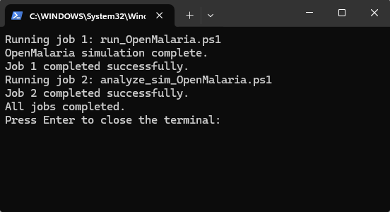
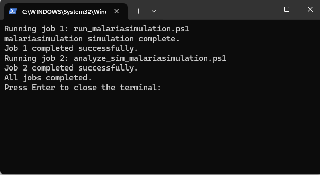

# Example run 


## HPC  

Coming soon...

## Local

Run in terminal: 
``` 
python .\launch_sim.py --models malariasimulation OpenMalaria --test 
```

  


OpenMalaria 
  


malariasimulation



## Simulation directories

**Experiments**  

`simulations_local/experiments/20250202_TEST/sims_dynamic_perennial__19_33_36`

**Simulation outputs**
`simulations_local/simulation_outputs/20250202_TEST/sims_dynamic_perennial__19_33_36`


# Example outputs


mmmpy_timeavrg.csv 

| index | nHost    | prevalence_2to10 | prevalence | clinical_incidence | severe_incidence | mortality | ageGroup | scen_id | output_target | seasonality | entomology_mode | num_seeds | cm_clinical | cm_severe | cm_start | model_input_malariasimulation | model_input_OpenMalaria | seed | malariasimulation_pv | inputEIR | simulatedEIR | n_total_mos_pop | n_infectious_mos |
|-------|----------|------------------|------------|--------------------|------------------|-----------|----------|---------|---------------|-------------|-----------------|-----------|-------------|-----------|----------|-------------------------------|-------------------------|------|----------------------|----------|--------------|-----------------|------------------|
| 1     | 29.22192 | 0.229265         | 0.039565   | 0.266923           | 0.000136         | 0.003592  | 0-0.5    | 1       | 0.2           | perennial   | dynamic         | 3         | 0           | 0         | 1        | 2.262334                      | 1.62434                 | 1    | 389                  | 1.624338 | 1.866924     | 107933.7        | 1823.24          |
| 2     | 29.56986 | 0.213848         | 0.029741   | 0.257018           | 0.000229         | 0.003646  | 0-0.5    | 1       | 0.2           | perennial   | dynamic         | 3         | 0           | 0         | 1        | 2.262334                      | 1.62434                 | 2    | 119                  | 1.624338 | 1.776915     | 110223.8        | 1790.495         |
| 3     | 29.23562 | 0.201827         | 0.023522   | 0.287321           | 0.000188         | 0.002093  | 0-0.5    | 1       | 0.2           | perennial   | dynamic         | 3         | 0           | 0         | 1        | 2.262334                      | 1.62434                 | 3    | 521                  | 1.624338 | 1.455988     | 105702.3        | 1450.148         |
| 1     | 17.1726  | 0.229265         | 0.123644   | 0.815252           | 0.004088         | 0.010307  | 0.5-1    | 1       | 0.2           | perennial   | dynamic         | 3         | 0           | 0         | 1        | 2.262334                      | 1.62434                 | 1    | 389                  | 1.624338 | 1.866924     | 107933.7        | 1823.24          |
| 2     | 17.07397 | 0.213848         | 0.098363   | 0.773107           | 0.008504         | 0.015926  | 0.5-1    | 1       | 0.2           | perennial   | dynamic         | 3         | 0           | 0         | 1        | 2.262334                      | 1.62434                 | 2    | 119                  | 1.624338 | 1.776915     | 110223.8        | 1790.495         |
| 3     | 17.31781 | 0.201827         | 0.112324   | 0.785319           | 0.005046         | 0.009301  | 0.5-1    | 1       | 0.2           | perennial   | dynamic         | 3         | 0           | 0         | 1        | 2.262334                      | 1.62434                 | 3    | 521                  | 1.624338 | 1.455988     | 105702.3        | 1450.148         |
| 1     | 30.47123 | 0.229265         | 0.13307    | 1.082989           | 0.012506         | 0.009547  | 2-Jan    | 1       | 0.2           | perennial   | dynamic         | 3         | 0           | 0         | 1        | 2.262334                      | 1.62434                 | 1    | 389                  | 1.624338 | 1.866924     | 107933.7        | 1823.24          |
| 2     | 29.74247 | 0.213848         | 0.119197   | 0.8271             | 0.013502         | 0.010006  | 2-Jan    | 1       | 0.2           | perennial   | dynamic         | 3         | 0           | 0         | 1        | 2.262334                      | 1.62434                 | 2    | 119                  | 1.624338 | 1.776915     | 110223.8        | 1790.495         |
| 3     | 31.24384 | 0.201827         | 0.121887   | 0.940986           | 0.009814         | 0.005112  | 2-Jan    | 1       | 0.2           | perennial   | dynamic         | 3         | 0           | 0         | 1        | 2.262334                      | 1.62434                 | 3    | 521                  | 1.624338 | 1.455988     | 105702.3        | 1450.148         |
| 1     | 81.92055 | 0.229265         | 0.191933   | 1.259757           | 0.017883         | 0.004393  | 5-Feb    | 1       | 0.2           | perennial   | dynamic         | 3         | 0           | 0         | 1        | 2.262334                      | 1.62434                 | 1    | 389                  | 1.624338 | 1.866924     | 107933.7        | 1823.24          |
| 2     | 81.75068 | 0.213848         | 0.171353   | 1.294179           | 0.020479         | 0.006474  | 5-Feb    | 1       | 0.2           | perennial   | dynamic         | 3         | 0           | 0         | 1        | 2.262334                      | 1.62434                 | 2    | 119                  | 1.624338 | 1.776915     | 110223.8        | 1790.495         |
| 3     | 81.81096 | 0.201827         | 0.157028   | 1.156324           | 0.015488         | 0.004428  | 5-Feb    | 1       | 0.2           | perennial   | dynamic         | 3         | 0           | 0         | 1        | 2.262334                      | 1.62434                 | 3    | 521                  | 1.624338 | 1.455988     | 105702.3        | 1450.148         |
| 1     | 126.4521 | 0.229265         | 0.25345    | 1.505709           | 0.01387          | 0.002468  | 10-May   | 1       | 0.2           | perennial   | dynamic         | 3         | 0           | 0         | 1        | 2.262334                      | 1.62434                 | 1    | 389                  | 1.624338 | 1.866924     | 107933.7        | 1823.24          |
| 2     | 129.063  | 0.213848         | 0.240766   | 1.543432           | 0.015919         | 0.004453  | 10-May   | 1       | 0.2           | perennial   | dynamic         | 3         | 0           | 0         | 1        | 2.262334                      | 1.62434                 | 2    | 119                  | 1.624338 | 1.776915     | 110223.8        | 1790.495         |
| 3     | 127.1973 | 0.201827         | 0.230642   | 1.270468           | 0.012767         | 0.004603  | 10-May   | 1       | 0.2           | perennial   | dynamic         | 3         | 0           | 0         | 1        | 2.262334                      | 1.62434                 | 3    | 521                  | 1.624338 | 1.455988     | 105702.3        | 1450.148         |
| 1     | 117.3123 | 0.229265         | 0.326584   | 1.559938           | 0.007902         | 0.003537  | 15-Oct   | 1       | 0.2           | perennial   | dynamic         | 3         | 0           | 0         | 1        | 2.262334                      | 1.62434                 | 1    | 389                  | 1.624338 | 1.866924     | 107933.7        | 1823.24          |
| 2     | 115.4849 | 0.213848         | 0.304588   | 1.56384            | 0.010591         | 0.005669  | 15-Oct   | 1       | 0.2           | perennial   | dynamic         | 3         | 0           | 0         | 1        | 2.262334                      | 1.62434                 | 2    | 119                  | 1.624338 | 1.776915     | 110223.8        | 1790.495         |
| 3     | 116.789  | 0.201827         | 0.307216   | 1.428216           | 0.008369         | 0.002761  | 15-Oct   | 1       | 0.2           | perennial   | dynamic         | 3         | 0           | 0         | 1        | 2.262334                      | 1.62434                 | 3    | 521                  | 1.624338 | 1.455988     | 105702.3        | 1450.148         |
| 1     | 101.9562 | 0.229265         | 0.367066   | 1.692884           | 0.004996         | 0.001818  | 15-20    | 1       | 0.2           | perennial   | dynamic         | 3         | 0           | 0         | 1        | 2.262334                      | 1.62434                 | 1    | 389                  | 1.624338 | 1.866924     | 107933.7        | 1823.24          |
| 2     | 100.4932 | 0.213848         | 0.36325    | 1.590158           | 0.006466         | 0.00278   | 15-20    | 1       | 0.2           | perennial   | dynamic         | 3         | 0           | 0         | 1        | 2.262334                      | 1.62434                 | 2    | 119                  | 1.624338 | 1.776915     | 110223.8        | 1790.495         |
| 3     | 100.2027 | 0.201827         | 0.296741   | 1.467026           | 0.005106         | 0.003178  | 15-20    | 1       | 0.2           | perennial   | dynamic         | 3         | 0           | 0         | 1        | 2.262334                      | 1.62434                 | 3    | 521                  | 1.624338 | 1.455988     | 105702.3        | 1450.148         |
| 1     | 495.4932 | 0.229265         | 0.357386   | 1.089016           | 0.001195         | 0.000621  | 20-100   | 1       | 0.2           | perennial   | dynamic         | 3         | 0           | 0         | 1        | 2.262334                      | 1.62434                 | 1    | 389                  | 1.624338 | 1.866924     | 107933.7        | 1823.24          |
| 2     | 496.8219 | 0.213848         | 0.351285   | 1.125957           | 0.001531         | 0.000627  | 20-100   | 1       | 0.2           | perennial   | dynamic         | 3         | 0           | 0         | 1        | 2.262334                      | 1.62434                 | 2    | 119                  | 1.624338 | 1.776915     | 110223.8        | 1790.495         |
| 3     | 496.2027 | 0.201827         | 0.291838   | 0.987903           | 0.001359         | 0.000608  | 20-100   | 1       | 0.2           | perennial   | dynamic         | 3         | 0           | 0         | 1        | 2.262334                      | 1.62434                 | 3    | 521                  | 1.624338 | 1.455988     | 105702.3        | 1450.148         |
| 1     | 158.7863 | 0.229265         | 0.145211   | 0.995048           | 0.012093         | 0.005874  | 0-5      | 1       | 0.2           | perennial   | dynamic         | 3         | 0           | 0         | 1        | 2.262334                      | 1.62434                 | 1    | 389                  | 1.624338 | 1.866924     | 107933.7        | 1823.24          |
| 2     | 158.137  | 0.213848         | 0.127183   | 0.956133           | 0.014088         | 0.00763   | 0-5      | 1       | 0.2           | perennial   | dynamic         | 3         | 0           | 0         | 1        | 2.262334                      | 1.62434                 | 2    | 119                  | 1.624338 | 1.776915     | 110223.8        | 1790.495         |
| 3     | 159.6082 | 0.201827         | 0.120844   | 0.91474            | 0.010442         | 0.004663  | 0-5      | 1       | 0.2           | perennial   | dynamic         | 3         | 0           | 0         | 1        | 2.262334                      | 1.62434                 | 3    | 521                  | 1.624338 | 1.455988     | 105702.3        | 1450.148         |
| 1     | 1000     | 0.229265         | 0.307926   | 1.2436             | 0.005703         | 0.002153  | 0-100    | 1       | 0.2           | perennial   | dynamic         | 3         | 0           | 0         | 1        | 2.262334                      | 1.62434                 | 1    | 389                  | 1.624338 | 1.866924     | 107933.7        | 1823.24          |
| 2     | 1000     | 0.213848         | 0.297392   | 1.2502             | 0.006916         | 0.003027  | 0-100    | 1       | 0.2           | perennial   | dynamic         | 3         | 0           | 0         | 1        | 2.262334                      | 1.62434                 | 2    | 119                  | 1.624338 | 1.776915     | 110223.8        | 1790.495         |
| 3     | 1000     | 0.201827         | 0.259049   | 1.1116             | 0.005454         | 0.002272  | 0-100    | 1       | 0.2           | perennial   | dynamic         | 3         | 0           | 0         | 1        | 2.262334                      | 1.62434                 | 3    | 521                  | 1.624338 | 1.455988     | 105702.3        | 1450.148         |

