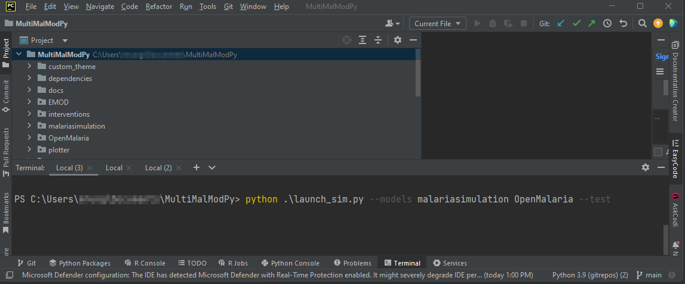

# Example run 


This example guides you through running simulations, assuming all requirements are met: the 
necessary software is installed and user settings are properly configured in `manifest.py`.  
You can visit the [installation ](../getting_started/installation.md) or the [first-time-configuration](../getting_started/configuration.md) pages if you need to modify your setup.

Note, you can also run MultiMalModPy from within a container, without any prior installation. Just download the image file from here and follow
the example run for running from within a container below. 

**In this section:**

- [HPC](#hpc)
  - [Using Python Virtual Environment](#using-python-virtual-environment-on-hpc)
  - [Using Singularity Container](#using-singularity-container)
- [Local](#local)
  - [Using Python Virtual Environment](#using-python-virtual-environment-on-local)
    - [Launch in Batch Mode](#launch-in-batch-mode)
    - [Using Docker Container](#using-docker-container)
    - [Launch in Interactive Mode](#launch-in-interactive-mode)


## HPC  

### Using python virtual environment on HPC

**Step 1: Navigate to the Repository and Activate the Virtual Environment**  

**1a) Navigate to the Repository**  
Open a terminal on your cluster and move into the MultiMalModPy repository using:  
``` 
cd <your_path>/MultiMalModPy  
```
Replace <your_path> with the actual path where the repository is located.

**1b) Activate the Virtual Environment**    
To ensure dependencies are properly managed, activate the virtual environment:
``` 
source <your_path>/my_venv//bin/activate  
```  
If you haven’t set up the virtual environment yet, follow the installation instructions [here](../getting_started/installation.md).    

**Step 2: Configure Simulation to run (Optional for First Test Run)**  
If you want to customize your simulation settings, the easiest way is to modify the `setup_sim.py` file and adjust the parameters as needed.
However, if this is your first test run, you can skip this step and proceed with the default settings.
Later, you’ll also learn how to run multiple simulations simultaneously using configurations from a CSV file.   

**Step 3: Launch simulations**  
 3a) To launch a simulation, use the following command:    
``` 
python launch_sim.py --models EMOD malariasimulation OpenMalaria --test
```  
You can choose to run all three models (EMOD, malariasimulation, and OpenMalaria) or specify only one or two by modifying the command accordingly.  
Check you simulations via `squeue -u <username>`. 

While simulations are running, check the `experiments` and the `simulation_outputs` folder of your current simulation running.
In the `experiments` folder, you will find log files for each step and model, as well as the input files used for the simulationper model.
In the `simulation_outputs` folder, you can review the scenarios that were submitted in `scen_df.csv`, and  the outputs appear in the folder once the simulation finishes.    


3b) Postprocessing (optional if manual re-run is required)
Since the postprocessing runs automatically once the simulation job finishes, there is  no extra step required to process simulation outputs.  
In case of further content-debugging or customization needs, you can go to `Customize and troubleshoot analyzer` section.  

**Step 4: View output**    
The figures will appear under  `simulation_outputs` .  

<div style="background-color: #E9F2F9; padding: 15px; border-left: 5px solid #00796b; margin: 20px 0; font-family: Arial, sans-serif;"> <strong><em>DONE!</em></strong>  
  If you see the CSV files and generated figures, congratulations—you've successfully run your first MultiMalModPy test simulation! 🎉  
 </div> 

<div style="background-color: #E9F2F9; padding: 15px; border-left: 5px solid #00796b; margin: 20px 0; font-family: Arial, sans-serif;"> <strong><em>📝 NOTE!</em></strong>  
  If the files are missing, check the log files for error messages and verify whether any raw simulation outputs were generated.  
  To debug or rerun specific steps, use the saved .sh files to execute each step separately and identify the issue.      <strong>malariasimulation</strong> and <strong>OpenMalaria</strong>. 
</div> 


### Using singularity container 


**Step 1: Navigate to the Repository and Activate the Virtual Environment**  

**1a) Navigate to the Repository**  
Open a terminal on your cluster and move into the MultiMalModPy repository using:  
``` 
cd <your_path>/MultiMalModPy  
```
Replace <your_path> with the actual path where the repository is located.

**1b) Load singularity and ensure image file exists**    

``` 
module load singularity
```
If you haven’t downloaded the image file yet, follow the download it from [here](../getting_started/installation.md) and save it under any directory on your HPC.    

You can look inside the container via:  
```
singularity shell /path/to/emodpy4.1-OM46-R4.4.1.sif
``` 

**Step 2: Configure Simulation to run (Optional for First Test Run)**  
If you want to customize your simulation settings, the easiest way is to modify the `setup_sim.py` file and adjust the parameters as needed.
However, if this is your first test run, you can skip this step and proceed with the default settings.
Later, you’ll also learn how to run multiple simulations simultaneously using configurations from a CSV file.   

**Step 3: Launch simulations**  
 3a) To launch a simulation, use the following command:    
``` 
singularity exec -B /etc/passwd -B /etc/slurm -B `which sbatch ` -B `which srun ` -B `which sacct ` -B `which scontrol ` -B `which salloc ` -B `which scancel ` -B `which squeue ` -B /usr/lib64/slurm/ -B /usr/lib64/liblua-5.1.so -B /usr/lib64/liblua-5.1.so:/usr/lib64/liblua.so -B /usr/lib64/libjson-c.so.2 -B /usr/lib64/libjson-c.so.2.0.1 -B /usr/lib64/libmunge.so.2 -B /usr/lib64/libmunge.so.2.0.0 -B /usr/lib64/libpmi2.so -B /usr/lib64/libpmi2.so.0 -B /usr/lib64/libpmi2.so.0.0.0 -B /usr/lib64/libpmi.so -B /usr/lib64/libpmi.so.0 -B /usr/lib64/libpmi.so.0.0.0 -B /usr/local/pmix -B /usr/local/hwloc -B /usr/local/ucx-1.13.0 -B /usr/local/ucx-1.10.0 -B /usr/local/ucx-1.8.1 -B /usr/local/spack -B /usr/local/spack_v20d1 -B /usr/local/libevent/ -B /run -B /projects -B /scratch --writable-tmpfs /home/mrm9534/rcs-support/emod-mrm/emodpy4.1-OM46-R4.4.1.sif /opt/envs/emodpy39/bin/python3 launch_sim.py --models EMOD -- test
```  
Note, the command includes at the very end the 
 - location of the image file `/home/mrm9534/rcs-support/emod-mrm/emodpy4.1-OM46-R4.4.1.sif`
 - location of the python virtual environment within the container `/opt/envs/emodpy39/bin/python3 launch_sim.py`
 - MultiMalModPy submission command `launch_sim.py --models EMOD -- test`

You can choose to run all three models (EMOD, malariasimulation, and OpenMalaria) or specify only one or two by modifying the command accordingly.  
Check you simulations via `squeue -u <username>`. 

While simulations are running, check the `experiments` and the `simulation_outputs` folder of your current simulation running.
In the `experiments` folder, you will find log files for each step and model, as well as the input files used for the simulationper model.
In the `simulation_outputs` folder, you can review the scenarios that were submitted in `scen_df.csv`, and  the outputs appear in the folder once the simulation finishes.    


3b) Postprocessing (optional if manual re-run is required)
Since the postprocessing runs automatically once the simulation job finishes, there is  no extra step required to process simulation outputs.  
In case of further content-debugging or customization needs, you can go to `Customize and troubleshoot analyzer` section.  

**Step 4: View output**    
The figures will appear under  `simulation_outputs` .  

<div style="background-color: #E9F2F9; padding: 15px; border-left: 5px solid #00796b; margin: 20px 0; font-family: Arial, sans-serif;"> <strong><em>DONE!</em></strong>  
  If you see the CSV files and generated figures, congratulations—you've successfully run your first MultiMalModPy test simulation! 🎉  
 </div> 

<div style="background-color: #E9F2F9; padding: 15px; border-left: 5px solid #00796b; margin: 20px 0; font-family: Arial, sans-serif;"> <strong><em>📝 NOTE!</em></strong>  
  If the files are missing, check the log files for error messages and verify whether any raw simulation outputs were generated.  
  To debug or rerun specific steps, use the saved .sh files to execute each step separately and identify the issue.      <strong>malariasimulation</strong> and <strong>OpenMalaria</strong>. 
</div> 


---------------------- 


## Local  

### Using python virtual environment on local

#### Launch in Batch Mode  

Open a CLI terminal (i.e. CMD, Pycharm, or RStudio terminal). In the example shown, a Pycharm terminal is used.  
And type in terminal the following command for a local test run.  

```   
python .\launch_sim.py --models malariasimulation OpenMalaria --test   
```  

**Pycharm**  
      


The resulting terminal output looks as below, after which two pop up windows appear:


<a href="https://github.com/ahadi-analytics/MultiMalModPy/tree/main/docs/img/launch_sim.py" target="_blank">   
  
</a>  

OpenMalaria 

<a href="https://github.com/ahadi-analytics/MultiMalModPy/tree/main/docs/img/run_OpenMalaria_local.png" target="_blank"> 
  
</a>


malariasimulation


<a href="https://github.com/ahadi-analytics/MultiMalModPy/tree/main/docs/img/run_malariasimulation_local.png" target="_blank">  
  
</a>


#### Using Docker Container

**NOTE: Running from within docker is currently being implemented.** 

Replace all `PATH_TO_REPO` with your directory to the MultiMalModPy on your computer, excluding 'MultiMalModPy'.
Example, if MultiMalModPy is in `C:/Users/<user>/Documents/MultiMalModPy`, then type  `C:/Users/<user>/Documents/`

```
docker run -it -v PATH_TO_REPO:/mnt/c/projects mmmpy_local:rocky8 /bin/bash -c "source /opt/envs/mmmpy_local/bin/activate && cd /mnt/c/projects/model-characterization && python launch_sim.py --models malariasimulation OpenMalaria --test"                         
```

#### Launch in Interactive Mode  

Sometimes it is useful or required to run line by line to understand and debug some lines of code.
You can open the MultiMalModPy project, for instance in PyCharm, and open the `launch_sim.py` file.
Then you can execute line by line interactively. Once you reach the end of the script, the powershell windows popup and simulations  are running.

**Just wan't to rerun the analyzer or plots?**
Also the analyzer and plotting scripts can be openned and run in an interactive mode. The only change required is to comment out the
`args` argument and to specify the `job_directory` and `models_to_run` directly in the script. 

## Experiment and simulation output directories

**Experiments**  

HPC:
`<User-defined job directory>/experiments/20250202_TEST/sims_dynamic_perennial__19_33_36`  
Local:   
`simulations_local/experiments/20250202_TEST/sims_dynamic_perennial__19_33_36`


**Simulation outputs**


HPC:
`<User-defined job directory>/simulation_outputs/20250202_TEST/sims_dynamic_perennial__19_33_36`  
Local:   
`simulations_local/simulation_outputs/20250202_TEST/sims_dynamic_perennial__19_33_36`


# Example outputs  

  

For details, see [Input and output files](../malaria_models/input_output.md)
