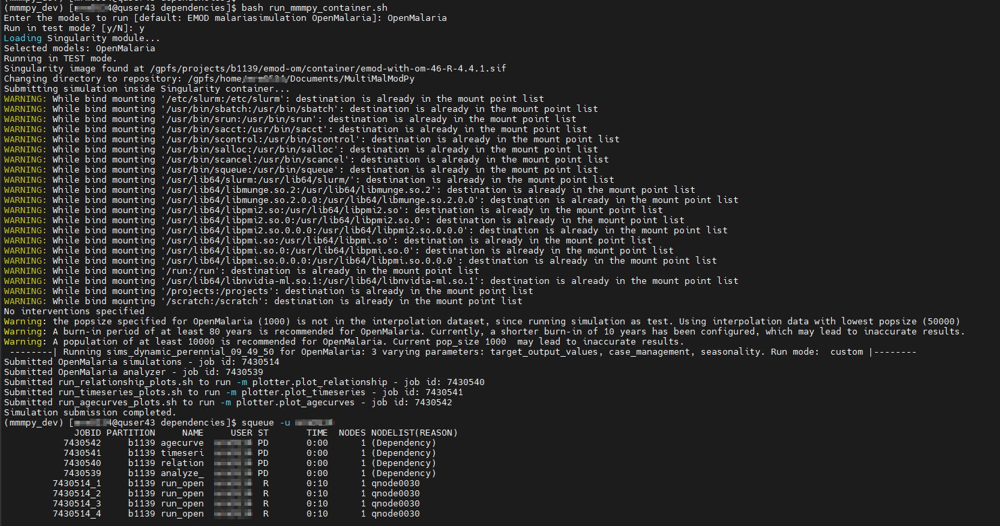

# How to Launch Simulations By Platform


<div style="background-color: #f4f4f4; padding: 20px; border-left: 5px solid #00796b; margin: 20px 0; font-family: Arial, sans-serif; font-size: 16px; color: #333;">
  <strong style="font-size: 18px; color: #00796b;"><em>Continue on this page if:</em></strong>
  <ul style="padding-left: 20px; line-height: 1.6; margin-top: 10px; margin-bottom: 0;">
    <li>✅ You have installed all required software
    </li>
    <li> ✅Your simulation is configured in <code>manifest.py</code>
    </li>
    <li> ✅You want to run MultiMalModPy from a container without manual installation
    </li>
    <li> ❌ If not, revisit the
    </li>
     &nbsp;➡️ <a href="../getting_started/installation.md">Installation guide</a>
     &nbsp;➡️ <a href="../getting_started/configuration.md">First-time configuration</a>
  </ul>
</div>

---


**Jump to**
Quickly navigate to your preferred execution method:   
🔹 [Run simulation – using Python virtual environment (HPC or local)](#using-python-virtual-environment-hpc-or-local)    
🔹 [Run simulation – using Singularity container (HPC)](#using-singularity-container-hpc)    
🔹 [Run simulation – using Docker (local)](#using-docker-local)    
🔹 [Troubleshooting](#-troubleshooting)  


## Using Python virtual environment (HPC or local)

-  Navigate to the cloned MultiMalModPy repository and activate the virtual environment.  
If you haven’t set up the virtual environment yet, follow the installation instructions [here](../getting_started/installation.md).      


- Launch test simulations.  

  - **HPC**:

``` 
python launch_sim.py --models EMOD malariasimulation OpenMalaria --test
```  

  - **Windows**:
      - Open a command-line interface (CLI) terminal such as CMD, PyCharm terminal, or RStudio terminal.

    
??? info "Show image run_from_pycharm"

      


<br/>

??? info "Show image"

      
    [View image file](https://github.com/ahadi-analytics/MultiMalModPy/tree/main/docs/img/2025-02-02 19_34_10-run_simulations.R.png)
 

<br/>

You can choose to run all three models (EMOD, malariasimulation, and OpenMalaria) or specify only one or two by modifying the command accordingly.


- **Monitor Simulation Progress**
  - on **HPC**:   
      - Check you simulations via `squeue -u <username>`.  
  - on Windows:  
      - EMOD: type in terminal `idmtools container status`  
      - malariasimulation and OpenMalaria: terminal windows per model appear.  


??? info "View CMD terminals"

    **OpenMalaria PSI**

      
    [View image file](https://github.com/ahadi-analytics/MultiMalModPy/blob/main/docs/img/run_OpenMalaria_local.png)

    **malariasimulation PSI**

      
    [View image file](https://github.com/ahadi-analytics/MultiMalModPy/blob/main/docs/img/run_malariasimulation_local.png)


------------------------------------  

## Using singularity container (HPC)

- **Navigate to the Repository**   
    Open a terminal on your cluster and move into the MultiMalModPy repository using:
    ``` 
    cd <your_path>/MultiMalModPy    
    ```
    Replace <your_path> with the actual path where the repository is located.  

- **Load singularity and ensure image file exists**
    ``` 
    module load singularity
    ```
    If you haven’t downloaded the image file yet, follow the download it from [here](../getting_started/installation.md) and save it under any directory on your HPC.     

- You can look inside the container via:    
    ```
    singularity shell /path/to/emodpy4.1-OM46-R4.4.1.sif  
    ```

- **Launch the Simulation**  
   To run the simulation, use the following command:  
    
    ```   
    cd dependencies
    dos2unix run_mmmpy_container.sh
    bash run_mmmpy_container.sh  
    ```   
 
  
You can choose to run all three models (EMOD, malariasimulation, and OpenMalaria) or specify only one or two by modifying the command accordingly.    


??? info "View terminal"

      
    [View image file](https://github.com/ahadi-analytics/MultiMalModPy/blob/main/docs/img/hpc_container_run_terminal.png)

      
- **Monitor Simulation Progress**   
      - Check simulations via 
       ```  
       squeue -u <username>
       ```  

------------- 

<br>


## Using Docker (local)

- To run MultiMalModPy inside a Docker container, double-click on `dependencies/run_mmmpy_docker.bat`.  
- Alternatively, you can follow manual steps as below (for developer, or troubleshooting).     


??? info "Manual steps to run using docker"  

    <br>  

    **Ensure the Docker image is available on your computer**   
    - If you haven’t installed it yet, refer to the [installation page](../getting_started/installation.md#local-docker-image)     
    
    **Set up your directory path:**   
    - In the example command below, replace `PATH_TO_REPO` with the directory path to your _MultiMalModPy_ folder on your computer, excluding the _MultiMalModPy_ directory itself. 
      - Example, if MultiMalModPy is in `C:/Users/<USER>/Documents/MultiMalModPy`, then type  `C:/Users/<USER>/Documents/`
    
    **Modify manifest.py:**     
    - Open the file and add the following line:  
        ```
        container_run = True             
        ```
    
    **Run the Docker container:**     
    - Use the following command, replacing PATH_TO_REPO with the actual path:  
     
    ```
    docker run -it -v <PATH_TO_REPO>:/mnt/c/projects mmmpy_local:rocky8 /bin/bash -c "source /opt/envs/mmmpy_local/bin/activate && cd /mnt/c/projects/MultiMalModPy && python launch_sim.py --models OpenMalaria --test"                           
    ```
    
    **What This Command Does:** 
    - Mount the local directory in which MultiMalModPy is located to /mnt/c/projects in the Docker container.  
      - Activate the Python virtual environment inside the container.  
      - Navigate to the MultiMalModPy directory inside the container and run the simulation script (`launch_sim.py`) with the specified models and test flag.  
    
    Example Terminal Output: 
    
        ```
        PS C:\Users\<USER>\Documents\MultiMalModPy> docker run -it -v C:/Users/<USER>/Documents/:/mnt/c/projects mmmpy_local:rocky8 /bin/bash -c "source /opt/envs/mmmpy_local/bin/activate && cd /mnt/c/projects/MultiMalModPy && python launch_sim.py --models  OpenMalaria --test"
        
        No interventions specified
        Warning: the popsize specified for malariasimulation (1000) is not in the interpolation dataset, since running simulation as test. Using interpolation data with lowest popsize (50000)
        Warning: the popsize specified for OpenMalaria (1000) is not in the interpolation dataset, since running simulation as test. Using interpolation data with lowest popsize (50000)
        Warning: A burn-in period of at least 80 years is recommended for OpenMalaria. Currently, a shorter burn-in of 10 years has been configured, which may lead to inaccurate results.
        Warning: A population of at least 10000 is recommended for OpenMalaria. Current pop_size 1000  may lead to inaccurate results.
        Warning: A burn-in period of at least 80 years is recommended for malariasimulation. Currently, a shorter burn-in of 10 years has been configured, which may lead to inaccurate results.
         --------| Running sims_dynamic_perennial_10_28_39 for malariasimulation, OpenMalaria: 3 varying parameters: target_output_values, case_management, seasonality. Run mode:  custom |--------
        ```
  

<br>  

-------------------- 


## Postprocessing   

**HPC**   
Postprocessing runs automatically once the simulation job completes. No additional steps are needed to generate outputs or plots.

 
**Windows (Local)**   
After the simulation finishes:

1. Navigate to the `experiments/` folder.
2. Double-click `plotter.bat` to generate the standard output plots.

> 📝 Note: Plotting does **not run automatically** on Windows unless you're using the containerized setup. Run the plot script manually after each simulation.  

    

## Troubleshooting   

If expected output files are missing, first check the `log/` folder inside the experiment directory for error messages.  
The `.err` and `.out` files can help determine whether the simulations completed successfully or if any issues occurred during execution.


<div style="background-color: #E9F2F9; padding: 15px; border-left: 5px solid #00796b; margin: 20px 0; font-family: Arial, sans-serif;">
  <strong><em>📝 NOTE</em></strong><br>
  To rerun specific steps, use the saved <code>.sh</code> scripts (HPC) or <code>.psi</code> files (local) to execute each step individually.<br>
  For debugging, you can also interactively use the framework from a Python console or Jupyter environment.
</div>

