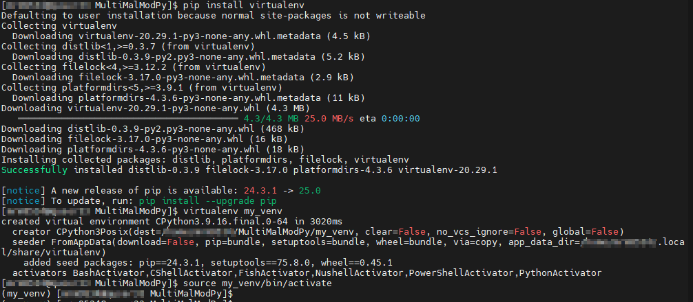
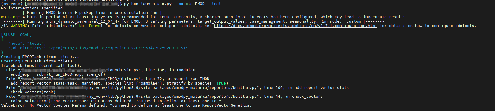

# Installation

Simulations are designed to run on a Linux-based high-performance cluster (HPC).   
However, installation instructions also include sections for local setup and container-based environments.

**In this section:**

- [Get MultiMalModPy](#get-multimalmodpy)
- [**HPC Setup**](#hpc)
    - [Create a Virtual Environment](#create-a-virtual-environment)
    - [Install EMOD](#install-emod)
    - [Install OpenMalaria](#install-openmalaria)
    - [Install malariasimulation](#install-malariasimulation)
- [**Local Setup**](#local-setup)
    - [Install OpenMalaria](#install-openmalaria)
    - [Install malariasimulation](#install-malariasimulation)
- [**Container Setup**](#container-setup)
    - [HPC](#hpc)
    - [Local machine](#local-machine)

<div style="background-color: #E9F2F9; padding: 15px; border-left: 5px solid #00796b; margin: 20px 0; font-family: Arial, sans-serif;"> <strong><em>📝 NOTE:</em></strong>  
   Functionality for local runs is  limited and intended only for test purposes using 
    <strong>malariasimulation</strong> and <strong>OpenMalaria</strong>. 
</div> 


<div style="background-color: #f4f4f4; padding: 20px; border-left: 5px solid #00796b; margin: 20px 0; font-family: Arial, sans-serif; font-size: 16px; color: #333;">
  <strong><em style="font-size: 18px; color: #00796b;">Software requirements:</em></strong>  
  <ul style="padding-left: 20px; line-height: 1.6; margin-top: 10px;">
    <li>MultiMalModPy</li>
    <li>Python 3.9.4</li>
    <li>R &gt;= 4.0.0</li>
    <li>malariasimulation 2.0.0</li>
    <li>emodpy==1.22.1</li>
    <li>emodpy-malaria 4.1.0</li>
    <li>idmtools-platform-slurm==2.0.2</li>
    <li>OpenMalaria v46+</li>
  </ul>
</div>


<div style="background-color: #E9F2F9;  padding: 10px; border-left: 5px solid #00796b; margin: 10px 0;">
  <strong><em>💡 TIP:</em></strong>
   Knowledge of shell, powershell, xml, json can be helpful when using MultiMalModPy.   
</div>  

<br>

## Get MultiMalModPy

To get started with MultiMalModPy, the recommended approach is
to [fork](https://github.com/ahadi-analytics/MultiMalModPy/fork)  the repository and clone it to your local machine or
cluster.
This allows you to easily update the code and contribute to the project.

Alternatively, you can download the latest release directly from the GitHub releases
page [here](https://github.com/numalariamodeling/model-characterization/releases). if you just need to use the software
without modifications.

``` 
cd <target_directory>  
git clone https://github.com/ahadi-analytics/MultiMalModPy.git  
```

or via [SSH](https://docs.github.com/en/authentication/connecting-to-github-with-ssh)

``` 
cd <target_directory>  
git clone git@github.com:ahadi-analytics/MultiMalModPy.git
```

## HPC

Before running MultiMalModPy on an HPC cluster, ensure that the necessary modules are loaded.
Use the following commands to load the required dependencies:

``` 
module load singularity/3.8.1 #singularity/3.7.0
module load git/2.8.2
module load python/3.8.4
module load R/4.4.0
```

### Create a virtual environment

MultiMalModPy works best when used within a virtual environment, as it helps manage dependencies and keep your project
isolated from other Python projects.

Follow the steps below to set up a virtual environment:

**Step 1: Install Python (if necessary)**
Make sure you have Python 3.8+ installed on your system. You can verify this by running in your terminal:

```
python --version
```

If you're working on an HPC cluster, you can load the Python module available on the system
via `module load python/3.8.4` (to check existing python versions run `module spider python`)
Alternatively, if running locally, and Python isn't installed, you can download and install the latest version from
python.org.

**Step 2: Install virtualenv**
If you don't have virtualenv installed, you can install it via pip:

```
pip install virtualenv
```

**Step 3: Create the Virtual Environment**
Navigate to the directory where you want to store your project, and then run the following command to create a virtual
environment:

```
virtualenv my_venv
```

This will create a folder named `my_venv` in your project directory that will contain the virtual environment.

**Step 4: Activate the Virtual Environment**  
On Windows:  `.\my_venv\Scripts\activate`

On macOS/Linux: `source my_venv/bin/activate`

Once activated, your terminal prompt will change to show the name of the virtual environment (e.g., (my_venv)).


<a href="https://github.com/ahadi-analytics/MultiMalModPy/tree/main/docs/img/activated_venv_terminal.png" target="_blank">

</a>

<br>


**Step 5: Install Dependencies**
Now that the virtual environment is activated, install MultiMalModPy's dependencies by running:
`pip install -r requirements.txt`

This will ensure that all required packages are installed within the virtual environment.

### Install EMOD

[Prerequisites](https://docs.idmod.org/projects/idmtools/en/latest/platforms/slurm/index.html#prerequisites):

- Linux client
- SLURM cluster access and general understanding
- Python 3.8/3.9/3.10/3.11/3.12 x64-bit (https://www.python.org/downloads/release)
- Python virtual environments

**Step 1: Activate venv (if not already active)**
On macOS/Linux: `source my_venv/bin/activate`

Optional: clean previous installed packages, only needed when a new idmtools Singularity image is
available : `rm –fr ~/.local/lib/python* `

**Step 2: Pull Singularity image containing Python and MPI**

```
curl https://packages.idmod.org:443/artifactory/idm-docker-public/idmtools/rocky_mpi/dtk_run_rocky_py39.sif -o dtk_run_rocky_py39.sif
```

**Step 3:Install emodpy-malaria and idmtools_platform_slurm**

Run the following command to install `emodpy-malaria`:

```
pip install emodpy-malaria --ignore-installed --index-url=https://packages.idmod.org/api/pypi/pypi-production/simple 
```

You may encounter the following warning which can be ignored.

<span style="color:#FFAA33">WARNING: You are using pip version 22.0.4; however, version 25.0 is available.
You should consider upgrading via the '~/my_venv/bin/python -m pip install --upgrade pip' command.</span>

Install the `idmtools_platform_slurm` package with this command:

```
pip install idmtools[slurm] --index-url=https://packages.idmod.org/api/pypi/pypi-production/simple
```

This may take a few minutes to build.
Again, if the 'pip install' warning appears, you can ignore it.
The outcome should look as below:

<a href="https://github.com/ahadi-analytics/MultiMalModPy/tree/main/docs/img/install_idmtools_platform_slurm_terminal.png" target="_blank">

</a>

<br>

Verify installation via:

```
idmtools --help
```

**Step 6: Verify installation and test run**     
You can check whether the installation was successfull by typing:

```
cd <custom_dir/MultiMalModPy>
python launch_sim.py --models EMOD --test
``` 

<br>

**Step 8: Update `manifest.py`**  
Make sure to update the manifest.py file with the necessary configurations. For first-time setup, refer to
the  [first time configurations](../getting_started/configuration/)

### Install OpenMalaria

**Step 1: Install OpenMalaria by following developer's site instructions**

Installation instructions can be found on
the [OpenMalaria wiki](https://github.com/SwissTPH/openmalaria/wiki/UserGuide#Installing-OpenMalaria) .


<details><summary><span>Installation instructions for the Northwestern University cluster:</span></summary>   
<p>

NU IT research built a container and sent instructions which have been edited for completeness and are
shown below:
One can build the container on Quest using the remote Sylabs build environment.

Updating to the latest OpenMalaria version:

1) Create a new folder for the version to install

```
mkdir /projects/b1139/OpenMalaria/om_v46/
```

And copy into the new folder the latest schema files (not source code), available
from https://github.com/SwissTPH/openmalaria/releases.

Copy the OpenMalaria.def and modules from the prevvious release to the new one.
Note these files were created
by [Scott Coughlin](https://www.it.northwestern.edu/departments/it-services-support/research/staff/coughlin.html) to
facilitate installation on Quest, without having to use cmake.

```
cp /projects/b1139/OpenMalaria/om_v43/OpenMalaria.def  /projects/b1139/OpenMalaria/om_v46/OpenMalaria.def
cp -r /projects/b1139/OpenMalaria/om_v43/modules  /projects/b1139/OpenMalaria/om_v46/
```

The def files includes the following lines and does not require change (for information shown below)

```
Bootstrap: docker
From: ubuntu:20.04

%post
    apt-get update && \
    DEBIAN_FRONTEND=noninteractive apt-get install -y --no-install-recommends \
        git \
        cmake \
        libboost-dev \
        libgsl-dev \
        libxerces-c-dev \
        xsdcxx \
        zlib1g-dev \
        python3 \
        build-essential

    git config --global http.sslverify false
    git clone https://github.com/SwissTPH/openmalaria.git /openmalaria
    cd openmalaria && ./build.sh -r
```

However, the `modules/openmalaria/43.0.lua` needs to be renamed to the new version, and its content also updated to the
latest version.

```
help([[
This git-repository contains source-code for Open Malaria, a simulator program for studying malaria epidemiology and the impacts of interventions against malaria.
]])

local pkgName = "openmalaria"
local version = "46.0"

whatis("Name: " .. pkgName)
whatis("Version: " .. version)

depends_on("singularity")

local bashStr = 'singularity exec -B /projects:/projects /projects/b1139/OpenMalaria/om_v46/OpenMalaria.sif /openmalaria/openMalaria-46.0/openMalaria "$@"'

set_shell_function("openMalaria",bashStr)
```

Then, actually install the latest OpenMalaria by generating a container following as follows:

```
module load singularity
singularity remote login
```

```
module load singularity
singularity remote login
```

An access token is already set for this remote. Replace it? [N/y] y
Generate an access token at https://cloud.sylabs.io/auth/tokens, and paste it here.

```
singularity build --remote OpenMalaria.sif OpenMalaria.def
```

Because calling containers is very annoying, Scott also added a module file in this folder which wraps the call to
openMalaria to make it easier to use, which is located in the modules/openmalaria folder copied and modified in an
earlier step (lua file)

Test to run new version

```
cd /projects/b1139/OpenMalaria/om_v46/
module use /projects/b1139/OpenMalaria/om_v46/modules/
module load openmalaria
openMalaria -s example_scenario.xml
```

</p>
</details>   

<br>


**Update `manifest.py`**

Make sure to update the manifest.py file with the necessary configurations. For first-time setup, refer to
the  [first time configurations](../getting_started/configuration/)

Define `OPENMALARIA_PATH` to point to the location of the required OpenMalaria files:

```
OPENMALARIA_PATH = "/projects/b1139/OpenMalaria/om_v43/"
```

No edits needed for `openmalaria_input_path` which defines the location of OpenMalaria

``` 
openmalaria_input_path = os.path.join(os.path.expanduser('~'), 'MultiMalModPy/OpenMalaria/')
```

If using the OpenMalaria module, configure `OPENMALARIA_venv` to load the necessary environment modules

```
OPENMALARIA_venv = f'\n\nmodule use {OPENMALARIA_PATH}/modules/ \nmodule load openmalaria\n'
```

### Install malariasimulation

**Step 1: Install R or load R module**
On HPC: `module load R/>=4.4.0` (required >=4.4.0).

**Step 2: Install R packages**

Open a R console and run `source(file.path('dependencies/install_packages.R'))`
Select a CRAN mirror, and packages will be installed thereafter:  
`--- Please select a CRAN mirror for use in this session ---`

**Step 3: Update `manifest.py`**
No edits needed for malariasimulation when running on HPC.

## Local Setup

### Install OpenMalaria

**Step 1: Create additional subfolders for OpenMalaria version i.e. `v46` under `dependencies`**

**Step 2: Download or copy OpenMalaria files**
Visit the OpenMalaria release page and download the requred version.
Alternatively, copy the files over from the installation on HPC for the respective version.

The OpenMalaria dependencies include:

- `autoRegressionParameters.csv`
- `densities.csv`
- `openMalaria.exe`
- `scenario_46.xsd`

**Step 3: Update `manifest.py`**
Make sure to update the manifest.py file with the necessary configurations. For first-time setup, refer to
the  [first time configurations](../getting_started/configuration/)

Define `OPENMALARIA_PATH` to point to the location of the required OpenMalaria files:

```
OPENMALARIA_PATH = os.path.join(ROOT_DIR, 'dependencies/OpenMalaria/om_v46')
```

No edits needed for `openmalaria_input_path` which defines the location of OpenMalaria

``` 
openmalaria_input_path = os.path.join(os.path.expanduser('~'), 'MultiMalModPy/OpenMalaria/')
```

`OPENMALARIA_venv` is not used when running on local machine.

```
OPENMALARIA_venv = ''
```

### Install malariasimulation

**Step 1: Install R or load R module**

Download and install the latest version of [R](https://www.r-project.org/) from CRAN.
For Windows users, also install [Rtools](https://cran.r-project.org/bin/windows/Rtools/)  from CRAN Rtools to ensure
compatibility with package compilation.

**Step 2: Install R packages**

Open an R console and run `source(file.path('dependencies/install_packages.R'))`
Select a CRAN mirror, and packages will be installed thereafter:  
`--- Please select a CRAN mirror for use in this session ---`

Install any additional R packages you may want to use for your project.

**Step 3: Update `manifest.py`**
Make sure to update the manifest.py file with the necessary configurations. For first-time setup, refer to
the  [first time configurations](../getting_started/configuration/)

Define the path to your local R installation:

``` 
r_local = "C:/Program Files/R/R-4.2.3/bin"
``` 

No edits needed for `malariasimulation_input_path` which defines the location of OpenMalaria

``` 
 malariasimulation_input_path = os.path.join(os.path.expanduser('~'), 'MultiMalModPy/malariasimulation/')
```

## Container Setup


A singularity container will be made available to allow running MultiMalModPy instantly, without the need for
installations.

Details on how to run simulations from within a container are described in the [Example run](../getting_started/example_run.md#using-singularity-container-)


<br>

## Troubleshooting

### EMOD examples


If you encounter an error and the test run does was not successful, you may need to rerun some installation commands.

- Missing python package or version conflict

<span style="color:#ff3232">ERROR: Could not find a version that satisfies the requirement click==7.1.2 
ERROR: No matching distribution found for click==7.1.2</span>

In that case the python package needs to be manually re-installed using

`pip install click==7.1.2`


- Issue with installing idmtools slurm:

<a href="https://github.com/ahadi-analytics/MultiMalModPy/tree/main/docs/img/idmtools_slurm_error_terminal.png" target="_blank">

</a>


Try again using the same command

  ```  
  pip install idmtools[slurm] --index-url=https://packages.idmod.org/api/pypi/pypi-production/simple
  ```  

- Python package version error:

  <span style="color:#ff3232"> ERROR: pip's dependency resolver does not currently take into account all the packages that are installed.
  This behaviour is the source of the following dependency conflicts. emodpy 1.22.1 requires click~=7.1, 
  but you have click 8.1.8 which is incompatible. </span> 
  - Run required package installation i.e.  

        pip install click==8.1.7    

  If a dependency conflict remains, let us know and try again to verify installation.


- EMOD ValueError: If it seems that EMOD is running, but you get a ValueError, this indicates that a wrong version of '
  emodpy-malaria' has been installed.
  Please let us know and we will update the online documentation.    
  An example is shown in the screenshot below:

<a href="https://github.com/ahadi-analytics/MultiMalModPy/tree/main/docs/img/emodpy_malaria_version_error_example.png" target="_blank">

</a>


