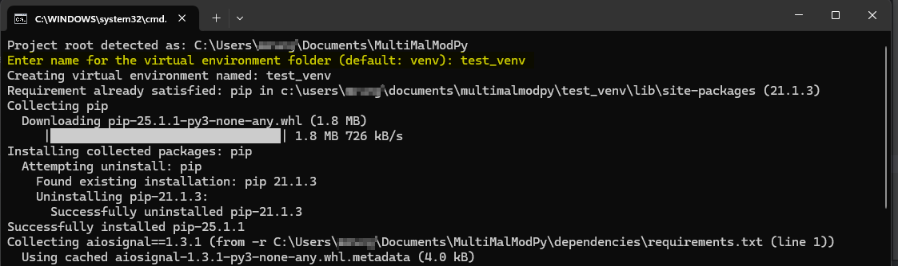
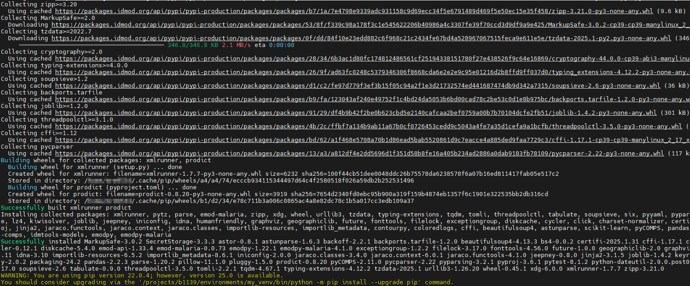
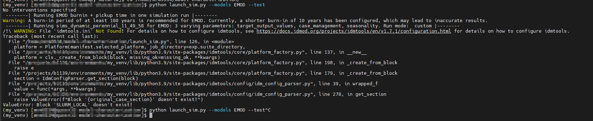

# Installation


This guide will walk you through:

- Choosing and setting up your environment (HPC, Docker, or native Python)  
- Cloning the MultiMalModPy repository  
- Installing required tools: EMOD, OpenMalaria, and malariasimulation  
- Running test simulations and verifying your setup  
- Using containerized options for quick testing (Docker or Singularity)  
- Common troubleshooting tips  


> ⚙️ **Platform Note**  
> MultiMalModPy is built for full-scale simulations on **Linux-based HPC clusters**.  
> Local Docker or native Python setups are supported for **testing only** — not for large-scale or multi-node runs.


## Prerequisites


<div style="background-color: #f4f4f4; padding: 20px; border-left: 5px solid #00796b; margin: 20px 0; font-family: Arial, sans-serif; font-size: 16px; color: #333;">
  <strong><em style="font-size: 18px; color: #00796b;">Software Requirements:</em></strong>  
  <ul style="padding-left: 20px; line-height: 1.5; margin-top: 5px; margin-bottom: 0px;">
    <li>Python 3.9.4</li>
    <li>R ≥ 4.0.0</li>
    <li>EMOD:
      <ul>
        <li>emodpy==1.22.1</li>
        <li>emodpy-malaria==4.1.0</li>
        <li>idmtools-platform-slurm==2.0.2</li>
      </ul>
    </li>
    <li>malariasimulation==2.0.0</li>
    <li>OpenMalaria v46+</li>
    <li>singularity/3.8.1 <em>or</em> Docker</li>
    <li>git/2.8.2</li>
  </ul>
</div>

📦 Note: All Python dependencies are listed in `dependencies/requirements.txt`

<div style="background-color: #E9F2F9;  padding: 10px; border-left: 5px solid #00796b; margin: 10px 0;">
  <strong><em>💡 TIP:</em></strong>
   Knowledge of shell, powershell, xml, json can be helpful when using MultiMalModPy.   
</div>  


<br>

---------------- 

## Clone MultiMalModPy

The recommended approach is to [fork the repo](https://github.com/ahadi-analytics/MultiMalModPy/fork) and clone it locally or to your HPC. Forking makes it easier to contribute and stay up-to-date.  
Alternatively, you can [**download the latest release**](https://github.com/ahadi-analytics/MultiMalModPy/releases).

- To clone using Git:   

**HTTPS**     
```  
cd <target_directory>  
git clone https://github.com/ahadi-analytics/MultiMalModPy.git    
```  
      
[SSH](https://docs.github.com/en/authentication/connecting-to-github-with-ssh)     

```
git clone git@github.com:ahadi-analytics/MultiMalModPy.git
```  

Or use **Git GUI client’s “Clone repository” feature**.


---------------- 

## Set Up Your Environment   

### Install Python and virtualvenv  

Ensure Python 3.8+ is installed:   

``` 
python --version  
```  

- **HPC**: Use your environment module system (e.g. module load python/3.9.16)   
- **Local**: Download from python.org   

 
Install virtualenv if not already available:  

``` 
pip install virtualenv  
```  

### Create Virtual Environment

 
Navigate to dependencies/ and run:  

- **macOS/Linux**  
    ``` 
    cd dependencies 
    bash create_mmmpy_venv.sh 
    ```  

- **Windows**   
   - click on `create_mmmpy_venv.bat`    

Alternatively, create manually:  

``` 
virtualenv my_venv 
source my_venv/bin/activate  # Linux/macOS 
.\my_venv\Scripts\activate   # Windows 
```  

Then install Python dependencies:  
```  
pip install -r dependencies/requirements.txt 
```  

Activate the Virtual Environment via:  

``` 
.\my_venv\Scripts\activate  # Linux/macOS 
source my_venv/bin/activate   # Windows 
``` 

Install Dependencies:    

``` 
pip install -r dependencies/requirements.txt 
``` 


??? info "Show terminal"

      
    [View image file](https://github.com/ahadi-analytics/MultiMalModPy/blob/main/docs/img/create_mmmpy_local_venv.bat.png)  

 


??? info "Show image"

      
    [View image file](https://github.com/ahadi-analytics/MultiMalModPy/tree/main/docs/img/activated_venv_terminal.png)  


---------------- 

## Install Malaria Models  

### EMOD  

Refer to  [idmtools SLURM prerequisites](https://docs.idmod.org/projects/idmtools/en/latest/platforms/slurm/index.html#prerequisites) for HPC  
 or [idmtools container prerequisites](https://docs.idmod.org/projects/idmtools/en/latest/platforms/container/index.html#prerequisites)  for local installs. 
 
Activate your virtual environment and run:    

``` 
# Pull Singularity image (HPC only)
curl https://packages.idmod.org:443/artifactory/idm-docker-public/idmtools/rocky_mpi/dtk_run_rocky_py39.sif -o dtk_run_rocky_py39.sif 

# Install EMOD packages
pip install emodpy-malaria --ignore-installed --index-url=https://packages.idmod.org/api/pypi/pypi-production/simple 
pip install idmtools[slurm] --index-url=https://packages.idmod.org/api/pypi/pypi-production/simple  # HPC 
pip install idmtools[container] --index-url=https://packages.idmod.org/api/pypi/pypi-production/simple  # Windows 
``` 

Verify:

```
idmtools --help
```

This may take a few minutes to build. 
If the 'pip install' warning appears, you can ignore it. 
The outcome should look as below: 

 <br>


??? info "Show image"

      
    [View image file](https://github.com/ahadi-analytics/MultiMalModPy/tree/main/docs/img/install_idmtools_platform_slurm_terminal.png)

 <br>


---------------- 

###  OpenMalaria  


Follow the [OpenMalaria wiki](https://github.com/SwissTPH/openmalaria/wiki/UserGuide#Installing-OpenMalaria).  

<br> 


???  "HPC users (e.g. NU cluster)"  
      
      NU IT research built a container and sent instructions which have been edited for completeness and are
      shown below:
      One can build the container on Quest using the remote Sylabs build environment.
      
      Updating to the latest OpenMalaria version:
      
      Create a new folder for the version to install
      
      ```
      mkdir /gpfs/projects/b1139/OpenMalaria/om_v46/
      ```
      
      And copy into the new folder the latest schema files (not source code), available 
      from https://github.com/SwissTPH/openmalaria/releases.
      
      Copy the OpenMalaria.def and modules from the prevvious release to the new one.
      Note these files were created
      by [Scott Coughlin](https://www.it.northwestern.edu/departments/it-services-support/research/staff/coughlin.html) to
      facilitate installation on Quest, without having to use cmake.
      
      ```
      cp /gpfs/projects/b1139/OpenMalaria/om_v43/OpenMalaria.def  /gpfs/projects/b1139/OpenMalaria/om_v46/OpenMalaria.def
      cp -r /gpfs/projects/b1139/OpenMalaria/om_v43/modules  /gpfs/projects/b1139/OpenMalaria/om_v46/
      ```
      
      The def files includes the following lines and does not require change (for information shown below) 
      
      ```  
      Bootstrap: docker 
      From: ubuntu:20.04  
      
      %post
          apt-get update && \
          DEBIAN_FRONTEND=noninteractive apt-get install -y --no-install-recommends \
              git \
              cmake \
              libboost-dev \
              libgsl-dev \
              libxerces-c-dev \
              xsdcxx \
              zlib1g-dev \
              python3 \
              build-essential
      
          git config --global http.sslverify false
          git clone https://github.com/SwissTPH/openmalaria.git /openmalaria
          cd openmalaria && ./build.sh -r
      ```  
      
      However, the `modules/openmalaria/43.0.lua` needs to be renamed to the new version, and its content also updated to the
      latest version. 
      
      ```  
      help([[
      This git-repository contains source-code for Open Malaria, a simulator program for studying malaria epidemiology and the impacts of interventions against malaria.
      ]])
      
      local pkgName = "openmalaria"
      local version = "46.0"
      
      whatis("Name: " .. pkgName)
      whatis("Version: " .. version)
      
      depends_on("singularity")
      
      local bashStr = 'singularity exec -B /projects:/projects /gpfs/projects/b1139/OpenMalaria/om_v46/OpenMalaria.sif /openmalaria/openMalaria-46.0/openMalaria "$@"'
      
      set_shell_function("openMalaria",bashStr)
      ```  
      
      Then, actually install the latest OpenMalaria by generating a container following as follows: 
      
      ```  
      module load singularity
      singularity remote login
      ```  
       
      An access token is already set for this remote. Replace it? [N/y] y 
      Generate an access token at https://cloud.sylabs.io/auth/tokens, and paste it here. 
      
      ```  
      singularity build --remote OpenMalaria.sif OpenMalaria.def
      ```  
      
      Because calling containers is very annoying, Scott also added a module file in this folder which wraps the call to 
      openMalaria to make it easier to use, which is located in the modules/openmalaria folder copied and modified in an
      earlier step (lua file)
      
      Test to run new version
      
      ```  
      cd /gpfs/projects/b1139/OpenMalaria/om_v46/
      module use /gpfs/projects/b1139/OpenMalaria/om_v46/modules/
      module load openmalaria
      openMalaria -s example_scenario.xml
      ```  

 
<br>


**Windows users:**  

  - Download the required files from OpenMalaria GitHub release   
  - Place them under `dependencies/OpenMalaria/om_v46` or respective version 
  - Required files:   
    - `autoRegressionParameters.csv`  
    - `densities.csv`  
    - `openMalaria.exe`  
    - `scenario_46.xsd`  


Update manifest.py with your paths. Example:   

```   
# HPC
OPENMALARIA_PATH = "/gpfs/projects/b1139/OpenMalaria/om_v46/" 
OPENMALARIA_venv = '\n\nmodule use {OPENMALARIA_PATH}/modules/ \nmodule load openmalaria\n' 

# Local (Windows) 
OPENMALARIA_PATH = os.path.join(ROOT_DIR, 'dependencies/OpenMalaria/om_v46') 
OPENMALARIA_venv = ''  
```  


---------------- 

### malariasimulation  

**Install R or load R module**  

- **HPC**:   

  `module load R/>=4.4.0` (required >=4.4.0). 

- **Local**: 
  - Install  [R](https://www.r-project.org/) and [Rtools](https://cran.r-project.org/bin/windows/Rtools/).   

**Install R packages** 
In an R session:    

```  
source(file.path('dependencies/install_packages.R')) 
```  

Update your manifest.py:   

``` 
r_local = "C:/Program Files/R/R-4.2.3/bin" 
``` 

<br> 

---------------- 

## Run MultiMalModPy Without Full Installation (Optional)    

### Using Singularity (HPC)   
 
 
``` 
singularity pull --arch amd64 library://rungma/multimalmodpy/mmmpy_hpc:rocky8 
``` 

See full run instructions:  [Example run](../getting_started/example_run.md#using-singularity-container)   

### Using Docker (Local)    

Navigate to dependencies and double click on `run_mmmpy_docker.bat`  

Manual Docker setup:    

``` 
# Pull the image
docker pull multimalmodpy/mmmpy_local:rocky8 

# Check that the image exists 
docker images 
``` 

``` 
# Run interactively (optional to test it)
source /opt/envs/mmmpy_local/bin/activate
cd /mnt/c/projects
python launch_sim.py --models OpenMalaria --test
``` 
Note: Inside Docker, you usually don’t need to activate a virtual environment. The Python in the image is ready to use.  

Mount local project to the container to run a test simulation (from host):  

```  
docker run -it -v <USERPATH>:/mnt/c/projects mmmpy_local:rocky8 `
  /bin/bash -c "source /opt/envs/mmmpy_local/bin/activate && cd /mnt/c/projects && python launch_sim.py --models OpenMalaria --test"
```  

🔁 Replace <USERPATH> with your local file path to MultiMalModPy repository (i.e. C:/Users/<USER>/Documents/MultiMalModPy).  
Replace OpenMalaria with malariasimulation, Running both models at once via docker container is not recommended in the current version.  


??? info "Developer view"  

    <br>  
    #### 1️⃣ Install Docker Desktop  

    Download and install from 🔗 [Docker Desktop](https://www.docker.com/products/docker-desktop/).  
    Ensure the Docker daemon is running:

    ```
    docker info
    ```

    If it's not running, open Docker Desktop (especially on Windows).

    #### 2️⃣ Pull the Docker Image

    Pull the container image from Docker Hub:

    ```
    docker pull multimalmodpy/mmmpy_local:rocky8
    ```

    🔗 [View image on Docker Hub](https://hub.docker.com/r/multimalmodpy/mmmpy_local)


    #### 3️⃣ Verify the Image

    Confirm the image exists locally:

    ```
    docker images
    ```

    Look for `multimalmodpy/mmmpy_local` with the tag `rocky8`.


    #### 4️⃣ Run the Docker Container

    Start the container in interactive mode:

    ```
    docker run -it --name mmmpy_local multimalmodpy/mmmpy_local:rocky8 /bin/bash
    ```

    To resume an existing container instead of creating a new one:

    ```
    docker ps -a               # List all containers
    docker start -ai mmmpy_local
    ```

    You should see a terminal like:

    ```
    [root@74350592befb /]#
    ```

    🛑 To exit the container, type:

    ```
    exit
    ```


    #### 5️⃣ Activate the Python Virtual Environment

    Check for available environments:

    ```
    ls /opt/envs/
    ```

    You'll likely see `mmmpy_local`.

    Activate the correct one:

    ```
    source /opt/envs/mmmpy_local/bin/activate
    ```

    Your prompt should look like:

    ```
    (mmmpy_local) [root@74350592befb envs]#
    ```

    Verify the Python setup:

    ```
    python --version
    pip list
    ```

    #### Run a Test Simulation (from Host System)

    If you're inside the container, `exit` first.

    Then run from your host terminal:

    ```
    docker run -it -v <USERPATH>:/mnt/c/projects \
      mrm9534/mmmpy_local:rocky8 \
      /bin/bash -c "source /opt/envs/mmmpy_local/bin/activate && cd /mnt/c/projects/MultiMalModPy && python launch_sim.py --models OpenMalaria --test"
    ```

    🔁 Replace `<USERPATH>` (e.g., `C:\Users\<USER>\Documents`) with the full path to your MultiMalModPy folder.  

    📘 More details: [Example Run – Docker Container](../getting_started/example_run.md#using-docker-container)  

<br />

---------------- 


## Verify Installation  

Run:  

``` 
python launch_sim.py --models EMOD malariasimulation OpenMalaria --test
``` 

Expected output: test simulation runs without errors and logs are generated.    


## Troubleshooting  

### EMOD  

??? info "EMOD Test Run Issues  "  
    
    If your test run using EMOD fails, it may be due to missing dependencies or version conflicts. Below are common issues and how to resolve them:  
    
    **Missing python package or version conflict**  
    
    <span style="color:#ff3232">
    ERROR: Could not find a version that satisfies the requirement click==7.1.2
    ERROR: No matching distribution found for click==7.1.2
    </span>
    
    Solution:
    Manually install the required version:
    `pip install click==7.1.2`
    
    If the installation of idmtools with SLURM support fails, you might see an error like this:
    
    ??? info "Show image"
    
          
        [View image file](https://github.com/ahadi-analytics/MultiMalModPy/tree/main/docs/img/idmtools_slurm_error_terminal.png)
    
    
    Solution:
    Retry the installation using:
    
      ```  
      pip install idmtools[slurm] --index-url=https://packages.idmod.org/api/pypi/pypi-production/simple
      ```  
    
    **Dependency Version Conflict**  
    
      <span style="color:#ff3232"> ERROR: pip's dependency resolver does not currently take into account all the packages that are installed.
      This behaviour is the source of the following dependency conflicts. emodpy 1.22.1 requires click~=7.1, 
      but you have click 8.1.8 which is incompatible. </span>  

      - Run required package installation i.e.   
    
            pip install click==8.1.7     
    
      If a dependency conflict remains, let us know and try again to verify installation.
    
    **EMOD ValueError (Likely Due to Wrong emodpy-malaria Version)**   
    
    - EMOD ValueError: If it seems that EMOD is running, but you get a ValueError, this indicates that a wrong version of '
      emodpy-malaria' has been installed.
      Please let us know and we will update the online documentation.     
      An example is shown in the screenshot below: 
    
    ??? info "Show image" 
    
          
        [View image file](https://github.com/ahadi-analytics/MultiMalModPy/tree/main/docs/img/emodpy_malaria_version_error_example.png)

<br>


