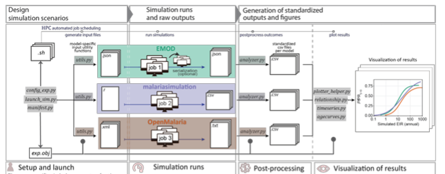

# Overview of MultiMalModPy Framework  

MultiMalModPy includes model-agnostic (global) and model-specific Python scripts.
The global scripts define parameters and manage the simulation, while the model-specific scripts handle sub-processes
such as input generation, output processing, and model features.
All parameters from the global scripts are written into a serializable `exp` object used by each model during
pre- and post-processing.  

  

The simulation process begins with user input of simulation parameters, specified in `setup_sim.py`. 
Once configured, simulations are submitted using launch_sim.py, and all defining parameters are stored in a serialized Python object (`exp.obj`).
This object ensures consistency throughout the simulation process.
Additionally, shell job submission scripts are generated to automate subsequent script execution,
streamlining the workflow. 

Standardized CSV output files for each model are used to generate a set of predefined figures, including relationships between outcomes,
time-series plots, and age-specific trends. 
These figures provide an initial visual analysis of the results and can be modified or extended by the user to 
accommodate specific research needs.  

The framework comes with three standardized plotting scripts:    
-  [plot_timeseries.py](../api/plotter/plot_timeseries.md) the timeseries for selected outcome measures,   
-  [plot_agecurves.py](../api/plotter/plot_agecurves.md) the relation of outcome measures by age groups,  
-  [plot_relationship.py](../api/plotter/plot_relationship.md) relationship between disease transmission and disease outcomes.  

# Repository Layout and Directory Structure

MultiMalModPy features a well-structured GitHub repository and two user-defined simulation directories: the experiments folder, which contains all simulation inputs and dependencies, and the simulation outputs folder, which stores standardized results for easy analysis.  

  

## Repository  
The MultiMalModPy repository is organized into back-end and front-end components:     
 **Back-end**: Contains subdirectories for each model, with model-specific functions for input handling, simulation execution, and output processing.  
    - utility – generic helper functions   
    - model-specific subdirectories:     
      – EMOD-specific helper functions     
      – malariasimualtion-specific helper functions    
      – OpenMalaria-specific helper functions    

 **Front-end**: Includes user-facing scripts located in the root directory:    
    - manifest.py – Manages configurations and dependencies.  
    - setup_sim.py – Prepares simulation environments and input data.  
    - launch_sim.py – Executes simulations and handles runtime operations.   
    - interventions/ – Additionally, when running with interventions, those parameters are defined in intervention-specific scripts in a separate folder. 
  
## Experiments folder   
This directory contains all necessary files for running simulations across three models. It includes:    
- Input files and dependencies.  
- Log outputs for tracking execution.  
- Shell scripts for automation and reproducibility.  

**Example:**  
- HPC:  `<User-defined job directory>/experiments/20250202_TEST/sims_dynamic_perennial__19_33_36`
- Local: `simulations_local/experiments/20250202_TEST/sims_dynamic_perennial__19_33_36`  

## Simulation output folder  
Stores simulation results in a standardized CSV format to ensure consistency across models. It also includes:  
- Structured data for easy comparison and interpretation:  
    – EMOD outputs     
    – malariasimualtion outputs  
    – OpenMalaria outputs    
- Pre-generated plots for quick analysis.    

**Example:**   
- HPC: `<User-defined job directory>/simulation_outputs/20250202_TEST/sims_dynamic_perennial__19_33_36`    
- Local:`simulations_local/simulation_outputs/20250202_TEST/sims_dynamic_perennial__19_33_36`  

**Next up:**  
  
- [How to use MultiMalModPy](../getting_started/usage.md)  
- [Input parameters and predefined options](../getting_started/parameters.md)  
- [Glossary](../getting_started/glossary.md)  
- [Installation and requirements](../getting_started/installation.md)  
- [First time configurations (manifest.py)](../getting_started/configuration.md)  

