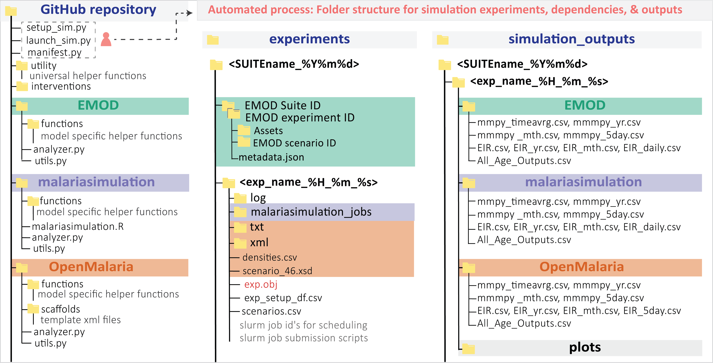

# Overview of MultiMalModPy Framework  

MultiMalModPy includes model-agnostic (global) and model-specific Python scripts.
The global scripts define parameters and manage the simulation, while the model-specific scripts handle sub-processes
such as input generation, output processing, and model features.
All parameters from the global scripts are written into a serializable `exp` object used by each model during
pre- and post-processing.  

  

# Repository Layout and Directory Structure

MultiMalModPy features a well-structured GitHub repository and two user-defined simulation directories: the experiments folder,   
which contains all simulation inputs and dependencies, and the simulation outputs folder, which stores standardized results for easy analysis.  

  

## Repository  
The MultiMalModPy repository is organized into back-end and front-end components:     
- **Back-end**: Contains subdirectories for each model, with model-specific functions for input handling, simulation execution, and output processing.  
    - utility – generic helper functions   
    - model-specific subdirectories:     
      – EMOD-specific helper functions     
      – malariasimualtion-specific helper functions    
      – OpenMalaria-specific helper functions    
- **Front-end**: Includes user-facing scripts located in the root directory:    
    - manifest.py – Manages configurations and dependencies.  
    - setup_sim.py – Prepares simulation environments and input data.  
    - launch_sim.py – Executes simulations and handles runtime operations.   
    - interventions/ – Additionally, when running with interventions, those parameters are defined in intervention-specific scripts in a separate folder. 
  
## Experiments folder   
This directory contains all necessary files for running simulations across three models. It includes:    
- Input files and dependencies.  
- Log outputs for tracking execution.  
- Shell scripts for automation and reproducibility.  

## Simulation output folder  
Stores simulation results in a standardized CSV format to ensure consistency across models. It also includes:  
- Structured data for easy comparison and interpretation:  
    – EMOD outputs     
    – malariasimualtion outputs  
    – OpenMalaria outputs    
- Pre-generated plots for quick analysis.    

**Next up:**  
  
- [How to use MultiMalModPy](.../getting_started/usage.md)  
- [Input parameters and predefined options](.../getting_started/parameters.md)  
- [Glossary](.../getting_started/glossary.md)  
- [Installation and requirements](.../getting_started/installation.md)  
- [First time configurations (manifest.py)](.../getting_started/configuration.md)  

