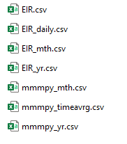

# How to use MultiMalModPy  

_This page provides an overview of the process steps_  

## Define a simulation
1. Open  `setup_sim.py` and modify parameters as needed (visit [building scenarios](../guide/scenarios.md) for details).

##  Running a simulation

1. Open a terminal and navigate to the repository: 
```bash
cd ~/MultiMalModPy
```

2. Run the Python script to define and launch the simulation: 
```bash
python launch_sim.py
```
This executes a test run using the default settings specified in the script and `parse_launch_args` (see `helper.py`).

3. Wait for simulations to finish: 
Once the simulations complete, analyzer scripts and default plots will automatically be generated.  

**Example submission lines**
 
- Testrun: Run a quick test with predefined settings:
  - `python launch_sim.py  --models EMOD MalSim OpenMalaria --test`

- Baseline run: Run simulations with default settings or modified defaults from the Python file:
  - `python launch_sim.py  --models EMOD MalSim OpenMalaria`
  - `python launch_sim.py  --models EMOD MalSim OpenMalaria  --rownum 0 --csv baseline_eirsweep_noCM`  

- Custom run: Run a simulation with specific interventions and test settings:
  - `python launch_sim.py  --models EMOD MalSim OpenMalaria --intervention cc_step --test --emodstep burnin`
  - `python launch_sim.py  --models EMOD MalSim OpenMalaria  --rownum 0 --csv cc_step_test`  


## View standardized simulation outputs 




**Time-series:**

- `mmmpy_yr.csv`: _Age-bin_ specific key malaria outcomes* over time aggregated by year
- `mmmpy_mth.csv`: _Age-bin_ specific key malaria outcomes* over time aggregated by month-year
- `mmmpy_5day.csv`: _Age-bin_ specific key malaria outcomes* over time aggregated by 5days-year


**Aggregated times for relationship and seasonality trends:**

- `mmmpy_timeavrg.csv`: _Age-group_ specific key malaria outcomes* and transmission outcomes**, aggregated over whole
  monitoring period

**Additional output files:**

- `EIR.csv`, `EIR_yr.csv`,  `EIR_mth.csv` and `EIR_daily.csv`: All age simulated EIR (added to benchmark output csvs)

### Standardized output measures

| Column             | Description                                                                                                        | EMOD                                                                                                                                                 | malariasimulation                                                                                                                     | OpenMalaria                                                                                                                                                              |   |
|:-------------------|:-------------------------------------------------------------------------------------------------------------------|:-----------------------------------------------------------------------------------------------------------------------------------------------------|:--------------------------------------------------------------------------------------------------------------------------------------|:-------------------------------------------------------------------------------------------------------------------------------------------------------------------------|---|
| index              | unique identifier (scenario * seed)                                                                                | Assigned as tag in the simulations                                                                                                                   | Assigned to csv scenario file name                                                                                                    | Assigned to xml scenario input file names                                                                                                                                |   |
| (input)            |                                                                                                                    |                                                                                                                                                      |                                                                                                                                       |                                                                                                                                                                          |   |
| date               | Simulation time converted to calendar dates                                                                        | Simulation start date + days that passed in the simulation                                                                                           | Simulation start date + days that passed in the simulation                                                                            | days = survey * 5 <br/>  date = year & month & ‘1’ for monthly aggregation)<br/>   month = days/365.0001/12 <br/>  year = days/365.0001                                  |   |
| year               | Simulation time to calendar year                                                                                   | daily timesteps/365                                                                                                                                  | daily timesteps/365                                                                                                                   | 73 5-day timesteps                                                                                                                                                       |   |
| ageGroup           | Age of human host population  Additional age aggregation performed for custom broader age groups specified by user | Age groups to write out specified in reporter,<br/> can be different from the agebins defined to specify demography                                  | Rendering of age groups need to be specified for each outcome,  <br/> can be different from the agebins defined to specify demography | Age groups that are written out are the same as  defined age bins in the demography section.  <br/>                                                                      |   |
| nHost              | human host population                                                                                              | Input population size is used as scaling factor for   population size defined in the demography file        <br/>  _'Average Population by Age Bin'_ | Input population size is written into corresponding   R parameter             Population is  written out per index   and age group n  | Input population size is written out per index and age group <br/>   _measure 0-‘nHost‘_ |   |
| prevalence         | Proportion of individuals with   patent infections                                                                 | Based on microscopy with defined diagnostic   threshold, written out per index, time, age bin  <br/>          _'PfPR by Age Bin'_                    | Calculated from `n_detect/ nHost` per index, time,   age bin            secondary outcome                                             | Calculated from `nPatent / nHost` per index, time,   age bin       _secondary outcome_                                                                              |   |
| prevalence_2to10   | Proportion of individuals with   patent infections in 2-10 year olds                                               | As above, written out for age 2 to 10 (separate   outcome in model)    <br/>   _PfPR_2to10_                                                          | Rendered separately  for age 2 to 10 (separate outcome in model) (?)                                                                  | As above, calculated mean across   `prevalence` of individuals aged 2 to 10 years                                                                                        |   |
| clinical_incidence | Number of clinical cases per   person per year (ppy)                                                               | Written out per index, time, age bin   <br/>    _Annual Clinical Incidence by Age Bin_                                                               | Calculated from `n_inc_clinical, nHost` and reporting   interval   <br/>  _secondary outcome_                                         | Calculated from `nUncomp, nHost` and reporting   interval <br/> _secondary outcome_                                                                                      |   |
| severe_incidence   | Number of severe cases per   person per year (ppy)                                                                 | Written out per index, time, age bin   <br/>       _Annual Severe Incidence by Age Bin_                                                              | Calculated from `n_inc_severe, nHost` and reporting   interval   <br/>  _secondary outcome_                                           | Calculated from `nSevere nHost` and reporting   interval  <br/>  _secondary outcome_                                                                                     |   |
| Simulated EIR      | Simulated EIR  - Time unit corresponds to the same as of the output file (daily, monthly, yearly)                  |                                                                                                                                                      |                                                                                                                                       |                                                                                                                                                                          |   |
| n_infectious_mos   | Number of infectious mosquitoes                                                                                    |                                                                                                                                                      |                                                                                                                                       |                                                                                                                                                                          |   |
| n_total_mos_pop    | Number of host-seeking mosquitoes                                                                                  |                                                                                                                                                      |                                                                                                                                       |                                                                                                                                                                          |   |

For details of raw model outputs, see [Input and output files](../malaria_models/input_output.md)  

Example `mmmpy_timeavrg.csv`   

| index | nHost    | prevalence_2to10 | prevalence | clinical_incidence | severe_incidence | mortality | ageGroup | scen_id | output_target | seasonality | entomology_mode | num_seeds | cm_clinical | cm_severe | cm_start | transmission_intensity_malariasimulation | transmission_intensity_OpenMalaria | seed | malariasimulation_pv | inputEIR | simulatedEIR | n_total_mos_pop | n_infectious_mos |
|-------|----------|------------------|------------|--------------------|------------------|-----------|----------|---------|---------------|-------------|-----------------|-----------|-------------|-----------|----------|------------------------------------------|-------------------------|------|----------------------|----------|--------------|-----------------|------------------|
| 1     | 29.22192 | 0.229265         | 0.039565   | 0.266923           | 0.000136         | 0.003592  | 0-0.5    | 1       | 0.2           | perennial   | dynamic         | 3         | 0           | 0         | 1        | 2.262334                                 | 1.62434                 | 1    | 389                  | 1.624338 | 1.866924     | 107933.7        | 1823.24          |
| 2     | 29.56986 | 0.213848         | 0.029741   | 0.257018           | 0.000229         | 0.003646  | 0-0.5    | 1       | 0.2           | perennial   | dynamic         | 3         | 0           | 0         | 1        | 2.262334                                 | 1.62434                 | 2    | 119                  | 1.624338 | 1.776915     | 110223.8        | 1790.495         |
| 3     | 29.23562 | 0.201827         | 0.023522   | 0.287321           | 0.000188         | 0.002093  | 0-0.5    | 1       | 0.2           | perennial   | dynamic         | 3         | 0           | 0         | 1        | 2.262334                                 | 1.62434                 | 3    | 521                  | 1.624338 | 1.455988     | 105702.3        | 1450.148         |


#### Customize figures  

Each existing plotting script allows users to define how outcomes are displayed, including colors, columns, and axes.  
To customize figures, modify the respective plotting scripts directly.  

#### Adding new figures   

Users can add custom plotting scripts to the `plotter` subdirectory.  

<div style="background-color: #E9F2F9;  padding: 10px; border-left: 5px solid #00796b; margin: 10px 0;">
  <strong><em>⚠️NOTE:</em></strong> 
  Use filenames that start with `plot_` for consistency and easier integration into the framework.
</div>  


Example usage:

``` 
python plotter/plot_custom1.py  --models EMOD malariasimulation OpenMalaria
```  


