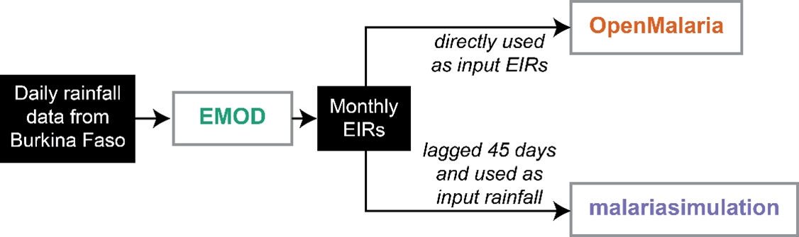

# Seasonality


The seasonal profile process begins with EMOD because its seasonality and climate files are too complex to be simplified 
into monthly values that describe the overall seasonal trend, as done for the other two models. 
By running EMOD simulations first, we establish a seasonality baseline that the other models can then be aligned to, 
ensuring consistency across simulations. 




## Generate seasonal profiles  

Our current environmental profile is created artifically to show a simple set up for each model to align to.
If you are interested in creating your own seasonal profile to feed in to the models. 


Follow the steps below.
FYI, at NU we have access to calculon which gets us weather data, if you also have access to follow calculon you can follow this process along, otherwise you will need to get the csv of air temp, land temp, humidity and rainfall
for your location through some other means.
First you will want to go in to the correct directory in your terminal. 

```
cd model-characterizaiton
cd EMOD/inputs
```

You will need to edit nodes.csv with the coordinates you are intersted in simulating, then you can run get_climate.py to generate EMOD's necessary .bin and .json files.
```
python get_climate.py
```

This will generate a folder with EMOD's required .json and .bin files, as well as a .csv you can edit to create custom seasonal behavior (we wouldn't recommend this to beginner level modelers).
IF you want to make custom changes to weather.csv and create custom .json and .bin files, then make those edits to the csv and run the following line of code
    python create_weather.py -generate_climate -climate_profile <csv name>

Once this job is done, make sure the climate files all have the prefix 'seasonal', and exist in the folder 'climate'. By default the files will have the prefix of the name of the .csv you used to generate the climate files.
If you prefer to keep the name of the .csv file you used (and not replace the seasonal files we provide) then please make sure that in setup_sim.py you change the seasonality from 'seasonal' to the .csv file name.

Now you need to run the calibration set up for EMOD, seasonal simulations ONLY. We use CM 0 to feed in to EMOD to later use as input for the other two models.
More detailed explanations for calib runs and production runs are included below, but for now we are just showing the simple command needed to run simulations.
Make sure you decide whether importation is turned on or off for EMOD, that should stay consistent throughout all your simulations.
```
python launch_sim.py -r calibrun --models EMOD
```

Once those simulations are done, you need to do a production run of EMOD, to get simulation outputs for an annual eir of 20.
We chose simulated annual eir of 20 to align on because EMOD's peak simulated EIR changed depending on transmission intensity (the other two models don't),
and we decided that simulated eir of 20 was a good middle ground to represent the average EMOD simulation.

```
python launch_sim.py -r productionrun --models EMOD --output_type eir
```

Once those simulations are done running, you should open up the mmmpy_mth.csv file. It will be found in the /simulation_outputs/<experiment name>/ folder.
In that file, you should have at least 20 EMOD simulations with monthly eir values, I would recommend taking filtering out the 20 simulations by the 0-100 age group and by the last year of your monitoring period.
Then, you should average the simulated EIR per month.
After that, inside the file utility/helper_simulation.py, there is a variable called season_month, you should replace the 12 values of seasonal month with your new 12 monthly values.
Once you have made that change you can now run calib run simulations for all three models.


