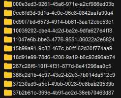
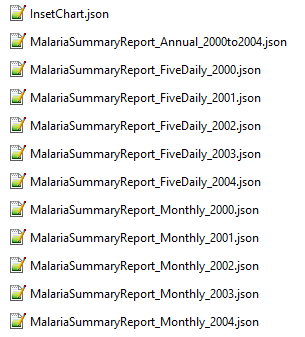

# Model-specific input and output files


## Input files

<div style="background-color: #E9F2F9; padding: 15px; border-left: 5px solid #00796b; margin: 20px 0; font-family: Arial, sans-serif;"> <strong><em>📌 Model Insider: Input formats</em></strong>    

The structure and format of input files differ across the three models.
  <ul style="padding-left: 20px; line-height: 1.6; margin-top: 10px;">
    <li><strong>EMOD:</strong> Uses multiple input files per scenario (e.g., demographics, configuration, and campaign files), generated in Python. <em>[Format: JSON]</em></li>
    <li><strong>malariasimulation:</strong> Does not use separate input files; model parameters are embedded within the R package. <em>[Format: R]</em></li>
    <li><strong>OpenMalaria:</strong> Uses a single input file per scenario, generated from a scaffold and predefined snippets. <em>[Format: XML]</em></li>
  </ul>
</div> 

For details on configuring time-related parameters, see the [time](../guide/time.md) simulation guide.  

### EMOD  

EMOD uses multiple input files to set up disease simulations, defining factors like how the disease spreads, population  
details, and interventions.    
For a detailed overview of these input files, refer to the official  
documentation: https://docs.idmod.org/projects/emodpy-malaria/en/latest/emod/software-inputs.html.

Key input files:  
- demographics file 
- configuration file  
- campaign file  
- climate files  

**Implementation in MultiMalModPy:**  
- ... 
- ...
- ... 


### malariasimulation
malariasimulation comes with an R packages that includes all the necessary objects and configurations and no additional files are required.

**Implementation in MultiMalModPy:**
- a scenario CSV (`scen_df.csv`) is handled as an input for generate simulation scenarios  
- simulation parameters are derived from the `get_parameters` function and overwritten with scenario specific parameters (view script [here](https://github.com/ahadi-analytics/MultiMalModPy/blob/main/malariasimulation/functions/run_simulations.R#L77))

### OpenMalaria

In OpenMalaria, each simulation scenario is defined by a single XML input file (more details on the OpenMalaria
wiki [here](https://github.com/SwissTPH/openmalaria/wiki/ScenarioDesign)).

**Implementation in MultiMalModPy:**

- one XML main scaffold with placeholders for parameters or 'snippets' of XML lines to replace
- parameter replacements `@parameter_value@`
- snippet replacements i.e. `@demography@` is replaced by multiple lines (view demography
  snippet [here](https://github.com/ahadi-analytics/MultiMalModPy/blob/main/OpenMalaria/snippets/Ifakara_age_demography.txt))
- a scenario CSV (`scen_df.csv`) is handled as an input for generate simulation scenarios


## Output files

<div style="background-color: #E9F2F9; padding: 15px; border-left: 5px solid #00796b; margin: 20px 0; font-family: Arial, sans-serif;"> <strong><em>📌 Model Insider: Output formats</em></strong>    

The format and number of output files per single scenario varies across the three models.
  <ul style="padding-left: 20px; line-height: 1.6; margin-top: 10px;">
    <li><strong>EMOD:</strong> Multiple output files per scenario, as specified by the user with varying time aggregation and outcome measures [Format: JSON, CSV]</li>
    <li><strong>malariasimulation:</strong>  Single output file, after first-stage postprocessing from the generated R object, with daily outcome measures as requested by the user [Format: CSV]</li>
    <li><strong>OpenMalaria:</strong>: One (or two) output files per scenario, main output survey-based outcome metrics not-user-modifiable [Format: TXT]</li>
  </ul>
</div> 

### EMOD

**Output files**
After a simulation finishes, a reporter extracts, aggregates, and saves the data as an output report in the working
directory.
These reports summarize different aspects of the simulation and can be in JSON, CSV, or binary formats.
For a detailed overview of output files, refer to the official documentation:
https://docs.idmod.org/projects/emodpy-malaria/en/latest/emod/software-outputs.html
EMOD allows users to configure which reports are generated through specific settings.
By default, InsetChart.json is always created. More information described at:
https://docs.idmod.org/projects/emodpy-malaria/en/latest/emod/parameter-configuration-output.html

Key output files used in MultiMalModPy and examples:
- [InsetChart.json](https://docs.idmod.org/projects/emodpy-malaria/en/latest/emod/software-report-inset-chart.html)  
- [MalariaSummary report](https://docs.idmod.org/projects/emodpy-malaria/en/latest/emod/software-report-malaria-summary.html#)  

**Implementation in MultiMalModPy:**

- Raw output files are written into the EMOD specific experiments folder `experiments/<emod_id>/outputs`.
- Each output file is written into a scenario specific folder with unique IDs that are automatically assigned in
  EMOD, `MalariaSummaryReport_FiveDaily_2003.json`,...,`MalariaSummaryReport_FiveDaily_2003.json` etc.
- During postprocessing, data is extracted, transformed, and merged into a single CSV file(view the
  script [here](https://github.com/ahadi-analytics/MultiMalModPy/blob/main/EMOD/analyze_sim.py))

  

Under  `outputs` within each of the scenario folders:   

  

**Truncated and simplified example output from a MalariaSummaryReport:**
This example file shows output for 1 scenario, for 12 values for 1 year, for 8 age groups. 
```json 

{
    "Metadata": {
        "Start_Day": 1096,
        "Reporting_Interval": 5,
        "Age Bins": [0.5, 1, 2, 5, 10, 15, 20, 100],
        "Parasitemia Bins": [50, 500, 5000, 50000, 3.402823466385e+38],
        "Gametocytemia Bins": [50, 500, 5000, 50000, 3.402823466385e+38],
        "Infectiousness Bins": [20, 40, 60, 80, 100]
    },
    "DataByTime": {
        "Time Of Report": [1101, 1106, 1111, 1116, 1121, 1126, 1131, 1136, 1141, 1146, 1151, 1156, 1161, 1166, 1171, 1176, 1181, 1186, 1191, 1196, 1201, 1206, 1211, 1216, 1221, 1226, 1231, 1236, 1241, 1246, 1251, 1256, 1261, 1266, 1271, 1276, 1281, 1286, 1291, 1296, 1301, 1306, 1311, 1316, 1321, 1326, 1331, 1336, 1341, 1346, 1351, 1356, 1361, 1366, 1371, 1376, 1381, 1386, 1391, 1396, 1401, 1406, 1411, 1416, 1421, 1426, 1431, 1436, 1441, 1446, 1451, 1456, 1460],
        "Annual EIR": [0.26, 0.40, 0.29, 0.39, 0.32, 0.32, 0.32, 0.22, 0.40, 0.35, 0.18, 0.20, 0.18, 0.08, 0.03, 0.09, 0.20, 0.12, 0.12, 0.12, 0.15, 0.17, 0.28, 0.15, 0.22, 0.28, 0.40, 0.26, 0.28,
            "PfPR_2to10": [0.129, 0.122, 0.116, 0.116, 0.116, 0.110, 0.101, 0.092, 0.084, 0.086, 0.081, 0.076, 0.072, 0.070, 0.066, 0.060, 0.058, 0.048, 0.048, 0.048, 0.049, 0.048, 0.044, 0.041, 0.038, 0.038, 0.037, 0.032, 0.031, 0.034, 0.036, 0.035, 0.035, 0.035, 0.034, 0.033, 0.035, 0.035, 0.038, 0.038, 0.038, 0.043, 0.049, 0.052, 0.057, 0.058, 0.061, 0.067, 0.080, 0.093, 0.104, 0.118, 0.133, 0.142, 0.145, 0.145, 0.152, 0.156, 0.161, 0.155, 0.155, 0.158, 0.155, 0.155, 0.155, 0.157, 0.153, 0.152, 0.146, 0.141, 0.138, 0.128, 0.119, 0.108]
            "PfPR_2to10-True": [0.058, 0.055, 0.051, 0.050, 0.044, 0.047, 0.038, 0.038, 0.036, 0.031, 0.027, 0.026, 0.026, 0.026, 0.029, 0.026, 0.018, 0.013, 0.012, 0.015, 0.017, 0.017, 0.017, 0.017, 0.017, 0.017, 0.017, 0.017, 0.017, 0.017, 0.017, 0.017, 0.017, 0.017, 0.017, 0.017, 0.017, 0.017, 0.017, 0.017, 0.017, 0.017, 0.017, 0.018, 0.018, 0.019, 0.020, 0.020, 0.022, 0.025, 0.029, 0.034, 0.039, 0.041, 0.045, 0.050, 0.059, 0.068, 0.078, 0.087, 0.104, 0.108, 0.111, 0.109, 0.106, 0.104, 0.110, 0.111, 0.110, 0.093, 0.091, 0.095, 0.085, 0.079, 0.077, 0.080, 0.072, 0.071, 0.065, 0.064, 0.053, 0.049]
            "No Infection Streak": [0, 0, 0, 0, 0, 0, 0, 0, 0, 0, 0, 0, 0, 0, 0, 0, 0, 0, 0, 0, 0, 0, 0, 0, 0, 0, 0, 0, 0, 0, 0, 0, 0, 0, 0, 0, 0, 0, 0, 0, 0, 0, 0, 0, 0, 0, 0, 0, 0, 0, 0, 0, 0, 0, 0, 0, 0, 0, 0, 0, 0, 0, 0, 0, 0, 0, 0, 0, 0, 0, 0, 0, 0],
            "Fraction Days Under 1pct Infected": [0, 0, 0, 0, 0, 0, 0, 0, 0, 0, 0, 0, 0, 0, 0, 0, 0, 0, 0, 0, 0, 0, 0, 0, 0, 0, 0, 0, 0, 0, 0, 0, 0, 0, 0, 0, 0, 0, 0, 0, 0, 0, 0, 0, 0, 0, 0, 0, 0, 0, 0, 0, 0, 0, 0, 0, 0, 0, 0, 0, 0, 0, 0, 0, 0, 0, 0, 0, 0, 0, 0, 0, 0]
        },
        "DataByTimeAndAgeBins": {
            "PfPR by Age Bin": [[0.006, 0.0359, 0.030, 0.090, 0.134, 0.225, 0.286, 0.220], [0.010, 0.033, 0.029, 0.079, 0.140, 0.210, 0.281, 0.207], [1, ...8 age bins], [1, ...8 age bins], [1, ...8 age bins], [1, ...8 age bins], [1, ...8 age bins], [1, ...8 age bins], [1, ...8 age bins], [1, ...8 age bins], [1, ...8 age bins], [1, ...8 age bins]]
            "PfPR by Age Bin-True": [[1, ...8 age bins], [1, ...8 age bins], [1, ...8 age bins], [1, ...8 age bins], [1, ...8 age bins], [1, ...8 age bins], [1, ...8 age bins], [1, ...8 age bins], [1, ...8 age bins], [1, ...8 age bins], [1, ...8 age bins], [1, ...8 age bins]]
            "Pf Gametocyte Prevalence by Age Bin": []
            "Pf Gametocyte Prevalence by Age Bin-True": []
            "Mean Log Parasite Density by Age Bin": []
            "Mean Log Parasite Density by Age Bin-True": []
            "New Infections by Age Bin": []
            "Annual Clinical Incidence by Age Bin": []
            "Annual Severe Incidence by Age Bin": []
            "Average Population by Age Bin": []
            "Annual Severe Incidence by Anemia by Age Bin": []
            "Annual Severe Incidence by Parasites by Age Bin": []
            "Annual Severe Incidence by Fever by Age Bin": []
            "Annual Severe Anemia by Age Bin": []
            "Annual Moderate Anemia by Age Bin": []
            "Annual Mild Anemia by Age Bin": []
        },
        "DataByTimeAndPfPRBinsAndAgeBins": {
            "PfPR by Parasitemia and Age Bin": [[...], [...], [...], [...], [...]]
            "PfPR by Gametocytemia and Age Bin": []
            "Smeared PfPR by Parasitemia and Age Bin": []
            "Smeared PfPR by Gametocytemia and Age Bin": []
            "Smeared True PfPR by Parasitemia and Age Bin": []
            "Smeared True PfPR by Gametocytemia and Age Bin": []
        },
        "DataByTimeAndInfectiousnessBinsAndPfPRBinsAndAgeBins": {
            "Infectiousness by Gametocytemia and Age Bin": [[...], [...], [...], [...], [...]]
            "Age scaled Infectiousness by Gametocytemia and Age Bin": [],
            "Infectiousness by smeared Gametocytemia and Age Bin": []
            "Smeared Infectiousness by smeared Gametocytemia and Age Bin": []
            "Age scaled Smeared Infectiousness by smeared Gametocytemia and Age Bin": []
        }
    }

```


### malariasimulation

**Implementation in MultiMalModPy:**

- R object gets written into a CSV file.
- Raw output (CSV) files are written into the experiments folder `experiments/<SUITE>/<expname>/malariasimulation_jobs`.
- Each output file is labeled with a unique scenario index, resulting in simple numbered
  filenames `1_out.csv`,...,`100_out.csv` etc.
- During postprocessing, data is extracted, transformed, and merged into a single CSV file(view the
  script [here](https://github.com/ahadi-analytics/MultiMalModPy/blob/main/malariasimulation/analyze_sim.py))


**Example CSV**:


| timestep | infectivity | EIR_gamb | FOIM_gamb | mu_gamb | n_bitten | n_0_182 | n_inc_0_182 | p_inc_0_182 | n_183_365 | n_inc_183_365 | p_inc_183_365 | n_366_730 | n_inc_366_730 | p_inc_366_730 | n_731_1825 | n_inc_731_1825 | p_inc_731_1825 | n_1826_3650 | n_inc_1826_3650 | p_inc_1826_3650 | n_3651_5475 | n_inc_3651_5475 | p_inc_3651_5475 | n_5476_7300 | n_inc_5476_7300 | p_inc_5476_7300 | n_7301_36500 | n_inc_7301_36500 | p_inc_7301_36500 | n_inc_clinical_0_182 | p_inc_clinical_0_182 | n_inc_clinical_183_365 | p_inc_clinical_183_365 | n_inc_clinical_366_730 | p_inc_clinical_366_730 | n_inc_clinical_731_1825 | p_inc_clinical_731_1825 | n_inc_clinical_1826_3650 | p_inc_clinical_1826_3650 | n_inc_clinical_3651_5475 | p_inc_clinical_3651_5475 | n_inc_clinical_5476_7300 | p_inc_clinical_5476_7300 | n_inc_clinical_7301_36500 | p_inc_clinical_7301_36500 | n_inc_severe_0_182 | p_inc_severe_0_182 | n_inc_severe_183_365 | p_inc_severe_183_365 | n_inc_severe_366_730 | p_inc_severe_366_730 | n_inc_severe_731_1825 | p_inc_severe_731_1825 | n_inc_severe_1826_3650 | p_inc_severe_1826_3650 | n_inc_severe_3651_5475 | p_inc_severe_3651_5475 | n_inc_severe_5476_7300 | p_inc_severe_5476_7300 | n_inc_severe_7301_36500 | p_inc_severe_7301_36500 | n_infections | natural_deaths | S_count | A_count | D_count | U_count | Tr_count | ica_mean | icm_mean | ib_mean  | id_mean  | iva_mean | ivm_mean | n_detect_0_182 | p_detect_0_182 | n_detect_183_365 | p_detect_183_365 | n_detect_366_730 | p_detect_366_730 | n_detect_731_1825 | p_detect_731_1825 | n_detect_1826_3650 | p_detect_1826_3650 | n_detect_3651_5475 | p_detect_3651_5475 | n_detect_5476_7300 | p_detect_5476_7300 | n_detect_7301_36500 | p_detect_7301_36500 | n_730_3650 | n_detect_730_3650 | p_detect_730_3650 | E_gamb_count | L_gamb_count | P_gamb_count | Sm_gamb_count | Pm_gamb_count | Im_gamb_count | total_M_gamb | index | cm_clinical | seasonality | seed |
|----------|-------------|----------|-----------|---------|----------|---------|-------------|-------------|-----------|---------------|---------------|-----------|---------------|---------------|------------|----------------|----------------|-------------|-----------------|-----------------|-------------|-----------------|-----------------|-------------|-----------------|-----------------|--------------|------------------|------------------|----------------------|----------------------|------------------------|------------------------|------------------------|------------------------|-------------------------|-------------------------|--------------------------|--------------------------|--------------------------|--------------------------|--------------------------|--------------------------|---------------------------|---------------------------|--------------------|--------------------|----------------------|----------------------|----------------------|----------------------|-----------------------|-----------------------|------------------------|------------------------|------------------------|------------------------|------------------------|------------------------|-------------------------|-------------------------|--------------|----------------|---------|---------|---------|---------|----------|----------|----------|----------|----------|----------|----------|----------------|----------------|------------------|------------------|------------------|------------------|-------------------|-------------------|--------------------|--------------------|--------------------|--------------------|--------------------|--------------------|---------------------|---------------------|------------|-------------------|-------------------|--------------|--------------|--------------|---------------|---------------|---------------|--------------|-------|-------------|-------------|------|
| 1        | 0.023929    | 55.24666 | 0.007587  | 0.132   | 43       | 7       | 0           | 0           | 12        | 1             | 0.633199      | 17        | 1             | 0.50183       | 39         | 1              | 0.350403       | 79          | 2               | 2.624391        | 63          | 1               | 2.469632        | 53          | 3               | 1.737082        | 223          | 7                | 7.19469          | 0                    | 0                    | 0                      | 0.552457               | 0                      | 0.316279               | 0                       | 0.014367                | 0                        | 0.33811                  | 0                        | 0.005636                 | 0                        | 0.055698                 | 0                         | 0.040065                  | 0                  | 0                  | 0                    | 0.009605             | 0                    | 0.002357             | 0                     | 5.88E-05              | 0                      | 6.04E-04               | 0                      | 1.12E-05               | 0                      | 6.44E-05               | 0                       | 6.75E-05                | 16           | 0              | 63      | 366     | 3       | 68      | 0        | 106.8914 | 1.765447 | 113.104  | 62.14041 | 108.731  | 0.688289 | 5              | 4.99178        | 7                | 6.987666         | 10               | 9.972358         | 25                | 24.88486          | 56                 | 57.18696           | 39                 | 38.53884           | 20                 | 22.97553           | 62                  | 56.54915            | 118        | 81                | 82.07182          | 647645.3     | 18847.25     | 2808.176     | 15698.45      | 620.9452      | 223.3472      | 16542.74     | 1     | 0           | perennial   | 1    |
| 2        | 0.023727    | 55.24666 | 0.007587  | 0.132   | 29       | 7       | 0           | 0           | 12        | 1             | 0.62706       | 17        | 0             | 0             | 39         | 1              | 0.350237       | 79          | 3               | 2.003338        | 63          | 0               | 0.340245        | 53          | 0               | 0               | 223          | 6                | 7.050952         | 0                    | 0                    | 1                      | 0.527524               | 0                      | 0                      | 0                       | 0.014112                | 0                        | 0.082325                 | 0                        | 0                        | 0                        | 0                        | 0                         | 0.016113                  | 0                  | 0                  | 0                    | 0.008577             | 0                    | 0                    | 0                     | 5.80E-05              | 0                      | 1.87E-04               | 0                      | 0                      | 0                      | 0                      | 0                       | 3.74E-05                | 12           | 0              | 63      | 364     | 3       | 70      | 0        | 106.9142 | 1.739253 | 113.1647 | 62.15641 | 108.7536 | 0.678455 | 5              | 4.991781       | 7                | 6.987506         | 10               | 9.972254         | 25                | 24.88475          | 55                 | 55.21343           | 39                 | 39.15634           | 25                 | 22.29207           | 55                  | 56.62215            | 118        | 80                | 80.09819          | 647641       | 18847.14     | 2808.181     | 15691.31      | 628.0852      | 223.3472      | 16542.74     | 1     | 0           | perennial   | 1    |
| 3        | 0.023663    | 55.24666 | 0.007587  | 0.132   | 29       | 7       | 0           | 0           | 12        | 0             | 0             | 17        | 0             | 0             | 39         | 1              | 0.350244       | 79          | 1               | 1.154082        | 63          | 0               | 2.189253        | 53          | 2               | 1.080644        | 223          | 5                | 4.502856         | 0                    | 0                    | 0                      | 0                      | 0                      | 0                      | 0                       | 0.014115                | 0                        | 0.222163                 | 0                        | 0                        | 0                        | 0.089398                 | 0                         | 0.047611                  | 0                  | 0                  | 0                    | 0                    | 0                    | 0                    | 0                     | 5.79E-05              | 0                      | 2.86E-04               | 0                      | 0                      | 0                      | 9.01E-05               | 0                       | 6.60E-05                | 10           | 0              | 63      | 363     | 4       | 70      | 0        | 106.9249 | 1.713449 | 113.1802 | 62.16028 | 108.7642 | 0.668761 | 5              | 4.991782       | 7                | 6.990581         | 10               | 9.972257         | 25                | 24.88471          | 54                 | 55.21126           | 36                 | 38.30837           | 17                 | 22.28925           | 65                  | 56.8969             | 118        | 79                | 80.09597          | 647639.3     | 18847.31     | 2808.166     | 15685.1       | 634.295       | 223.3472      | 16542.74     | 1     | 0           | perennial   | 1    |
| 4        | 0.023497    | 55.24666 | 0.007587  | 0.132   | 34       | 7       | 1           | 0.669721    | 12        | 0             | 0             | 17        | 0             | 0             | 39         | 0              | 0.376109       | 79          | 1               | 1.476678        | 63          | 1               | 1.058949        | 53          | 0               | 0.342169        | 223          | 6                | 7.530663         | 0                    | 0.063753             | 0                      | 0                      | 0                      | 0                      | 0                       | 0                       | 0                        | 0.023001                 | 0                        | 0.00259                  | 0                        | 0                        | 0                         | 0.02173                   | 0                  | 0.003037           | 0                    | 0                    | 0                    | 0                    | 0                     | 0                     | 0                      | 4.31E-05               | 0                      | 6.99E-06               | 0                      | 0                      | 0                       | 4.54E-05                | 11           | 0              | 62      | 363     | 3       | 72      | 0        | 106.9313 | 1.688027 | 113.1868 | 62.15959 | 108.7705 | 0.659205 | 5              | 4.991783       | 7                | 6.990582         | 10               | 9.972261         | 25                | 24.88467          | 56                 | 54.23563           | 37                 | 37.45204           | 21                 | 21.72198           | 48                  | 56.95933            | 118        | 81                | 79.1203           | 647638.4     | 18845.42     | 2808.31      | 15679.67      | 639.6958      | 223.3472      | 16542.71     | 1     | 0           | perennial   | 1    |
| 5        | 0.023507    | 55.24666 | 0.007587  | 0.132   | 35       | 7       | 0           | 0           | 12        | 0             | 0             | 17        | 0             | 0             | 39         | 0              | 0.420354       | 79          | 0               | 1.761803        | 63          | 4               | 1.740675        | 53          | 2               | 1.414195        | 223          | 4                | 6.542305         | 0                    | 0                    | 0                      | 0                      | 0                      | 0                      | 0                       | 0                       | 0                        | 0                        | 0                        | 0.062957                 | 0                        | 0.034283                 | 0                         | 0.020451                  | 0                  | 0                  | 0                    | 0                    | 0                    | 0                    | 0                     | 0                     | 0                      | 0                      | 0                      | 7.67E-05               | 0                      | 4.11E-05               | 0                       | 3.59E-05                | 11           | 0              | 61      | 363     | 3       | 73      | 0        | 106.9399 | 1.662982 | 113.2002 | 62.16124 | 108.7789 | 0.649786 | 6              | 5.98985        | 7                | 6.990584         | 10               | 9.972264         | 25                | 24.88463          | 53                 | 53.24906           | 36                 | 37.44715           | 23                 | 21.71909           | 50                  | 56.958              | 118        | 78                | 78.13369          | 647638.2     | 18847.14     | 2808.178     | 15674.99      | 644.3929      | 223.3472      | 16542.73     | 1     | 0           | perennial   | 1    |


### OpenMalaria

OpenMalaria simulations generate two types of output **survey-based** and  **continuous monitoring** (
details [here](https://github.com/SwissTPH/openmalaria/wiki/MonitoringOutput)).

**Implementation in MultiMalModPy:**

- Currently, **MultiMalModPy** only supports **survey output**.
- Raw output (TXT) files are written into the experiments folder  `experiments/<SUITE>/<expname>/txt`.
- Each output file is labeled with a unique scenario index, resulting in simple numbered filenames `1.txt`,...,`100.txt`
  etc.
- During postprocessing, data is extracted, transformed, and merged into a single CSV file(view the
  script [here](https://github.com/ahadi-analytics/MultiMalModPy/blob/main/OpenMalaria/analyze_sim.py))

  
(_Example shows local run results, with default application Notepad++ to open TXT files_)

**Example TXT (truncated)**:

| survey number | third dimension | measure | value |
|---------------|-----------------|---------|-------|
| 1             | 1               | 0       | 14    |
| 1             | 2               | 0       | 10    |
| 1             | 3               | 0       | 14    |
| 1             | 4               | 0       | 46    |
| 1             | 5               | 0       | 63    |
| 1             | 1               | 1       | 7     |
| 1             | 2               | 1       | 8     |
| 1             | 3               | 1       | 14    |
| 1             | 4               | 1       | 46    |
| 1             | 5               | 1       | 62    |
| 1             | 1               | 3       | 5     |
| 1             | 2               | 3       | 6     |
| 1             | 3               | 3       | 12    |
| 1             | 4               | 3       | 38    |
| 1             | 5               | 3       | 45    |

(_Example shows a truncated TXT file with inserted column headers, that do not exist in the raw output_)    


